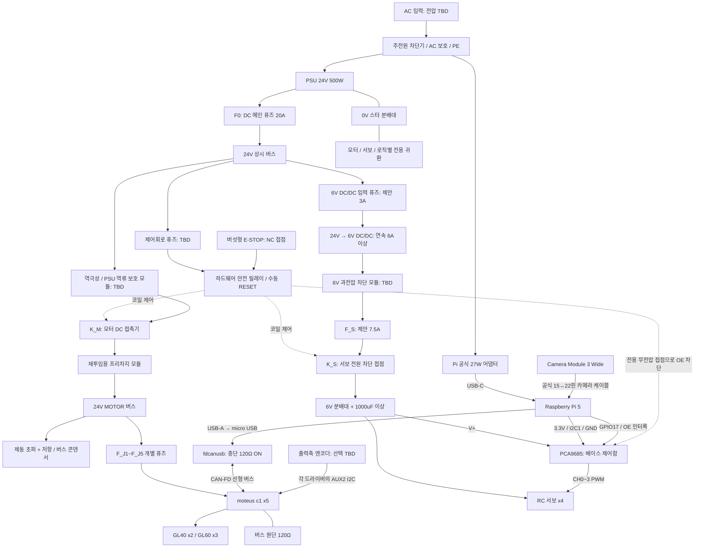

# arm1 v7 전장 배선 및 전기·제어 검증 회로 초안

작성일: 2026-11-13. 설계 상태: 검토용 Rev A. 커스텀 PCB 없음.

이 문서의 **확정**은 사용자 제공 사양 또는 아래 공식 자료에서 확인한 내용이다. **제안**은 설계 시작점이며 부품 정격이나 실측 결과가 아니다. 미확정 항목은 **TBD(확인 필요)**로 표시했다. 커넥터 핀 번호가 TBD인 곳은 제작 전 도통 확인이 필요하다. 전기적 안정성·제어 성능은 아직 실측 또는 시뮬레이션으로 검증하지 않았다.

기본안은 Pi·PCA9685·전원 분배를 베이스 제어함에 배치하고, moteus는 해당 모터 가까이에 장착하는 구성이다. CAN은 한 버스, 모터 전원은 개별 퓨즈 분기다. Pi는 공식 27W 어댑터로 별도 급전하고, 비상정지는 모터 및 서보 전원만 차단한다. 단, 전원 차단 시 팔 낙하·컵 이탈을 막는 수단은 별도로 필요하다.

## 1. 먼저 반영해야 할 사양 확인

| 항목 | 공식 자료 확인값 | 설계에서의 취급 |
|---|---|---|
| GL40 KV70 | 정격 전압 16V, 선간 저항 4.5Ω, 정격 전류 1.62 ADC, 피크 전류 3.3 ADC | 사용자 지정 24V 버스와 모터 정격 전압이 다름. 24V PWM 구동 허용 여부는 제조사 확인 필요 |
| GL60 KV25 | 정격 전압 24V, 선간 저항 5.5Ω, 정격 전류 1.35 ADC, 피크 전류 4 ADC | 전류 표기의 정의를 확인한 후 moteus 전류 제한으로 환산 |
| moteus c1 | 10V 최소, 24V 공칭, 51V 절대 최대, 피크 출력 20A | 51V는 운전 목표 전압이 아님. 출력 20A를 모터 허용 전류로 사용하지 않음 |
| fdcanusb | USB micro, CAN DB9, USB와 CAN GND 비절연, 소프트웨어 종단 | 실물 리비전 및 핀맵 확인 필요. 현재 공식 제품 페이지에는 후속 mjcanfd-usb-1x 안내 |

CubeMars의 ADC 표기를 moteus의 상전류·Iq·RMS 정의와 같다고 가정하지 않는다. 상전류 허용값과 연속 정지 토크 유지 시 열 한계는 **TBD(확인 필요)**다. 선간 저항도 단일 상저항과 다르며, 보유 모터 리비전 및 온도 조건을 확인해야 한다. 특히 GL40은 모터가 16V 정격이므로 이 부분이 풀리기 전에는 24V 운전을 승인할 수 없다. 드라이버에는 24V를 넣더라도 듀티·속도·전류·온도를 제한해야 하며, 구체 설정은 TBD다.

출처: [CubeMars GL40](https://www.cubemars.com/product/gl40-kv70-gimbal-motor.html), [CubeMars GL60](https://www.cubemars.com/product/gl60-kv25-gimbal-motor.html), [moteus 하드웨어 한계](https://mjbots.github.io/moteus/reference/hardware/), [fdcanusb](https://mjbots.com/products/fdcanusb/).

## 2. 시스템 블록 다이어그램



그림의 화살표는 전원 또는 신호의 개념적 연결이다. 모든 부하의 0V 귀환은 6절을 따른다. 제동 회로는 K_M 뒤에 둬서 K_M 개방 후에도 모터 버스에 연결되게 한다. 프리차지 모듈이 역방향 전류를 차단하더라도 각 드라이버와 제동 회로는 같은 부하측 버스에 있어야 한다.

**CAN 기본안:** `fdcanusb → J5 → J4 → J3 → J2 → J1 → 120Ω`. 이는 물리적 케이블 순서 제안이며 관절 번호를 바꾸지 않는다. ID는 각각 J1=1, J2=2, J3=3, J4=4, J5=5로 제안한다. 신호는 선형 버스, 전원은 개별 분기다. CAN 커넥터에 모터 전류를 흘리지 않는다.

5대라는 이유만으로 두 버스를 쓰지는 않는다. 먼저 단일 버스에서 목표 제어 주기, 지연 분포, 프레임 오류를 측정한다. 대역폭·배선·고장 분리 요구가 충족되지 않으면 A=J5/J4/J3, B=J2/J1로 나눈다. 이때 **독립 CAN-FD 어댑터 2채널 또는 어댑터 2개**, 버스마다 양끝 종단이 필요하다. fdcanusb 한 대를 Y 분기해 두 독립 버스로 만들 수 없다. 두 버스 간 명령 시간 차이도 측정해야 한다. MCP2515 및 일반 CAN 전용 장치는 사용하지 않는다.

## 3. 핀 대 핀 연결표

핀 번호는 Pi의 **물리 핀 번호**와 GPIO의 **BCM 번호**를 구분했다. 커넥터의 좌우 위치나 전선 색으로 번호를 추정하지 않는다.

### 3.1 Pi 5 / PCA9685 / 카메라

| 출발 | 도착 | 배선·설정 |
|---|---|---|
| Pi 물리 1: 3.3V | PCA VCC | 로직 전원만 공급. V+와 연결 금지 |
| Pi 물리 3: GPIO2/SDA1 | PCA SDA | 3.3V 풀업만 허용 |
| Pi 물리 5: GPIO3/SCL1 | PCA SCL | 초기 I2C 속도는 100kHz 제안 |
| Pi 물리 6: GND | 베이스 로직 0V 단자 → PCA GND | 서보 귀환 전류가 이 전선을 통과하지 않게 배치 |
| Pi 물리 11: GPIO17 | OE 인터록 K_OE의 RUN 접점 → PCA OE | 소프트웨어 HIGH=PWM 차단, LOW=허용 |
| Pi USB-A | fdcanusb USB micro | 기성 데이터 케이블. USB에서 어댑터 급전 |
| Pi USB-C | 공식 27W 어댑터 | GPIO 5V 핀 2/4에는 외부 전원 추가 연결하지 않음 |
| Pi CAM0 22핀 | 카메라 15핀 | 공식 Standard–Mini 카메라 케이블. CAM1도 설정 후 사용 가능 |
| Pi 물리 1의 3.3V | K_OE의 STOP 접점 | STOP 상태에서 OE를 HIGH로 강제; 24V를 OE에 넣지 않음 |

PCA 보드의 SDA/SCL 풀업은 VCC로 연결되므로 VCC=3.3V를 유지한다. OE는 보드 기본 풀다운 때문에 전원 투입 시 자동으로 안전한 HIGH가 된다고 가정하면 안 된다. K_OE는 **비여자 STOP에서 OE→3.3V, 여자 RUN에서 OE→GPIO17**로 전환하는 저레벨 신호용 break-before-make 무전압 접점이다. 모델·접점 번호·전환 특성은 **TBD(확인 필요)**다. 기성 DIN 인터페이스 릴레이를 사용하며 Pi로 코일을 직접 구동하지 않는다.

부팅 중에는 K_M/K_S/K_OE가 비여자 상태여야 한다. GPIO17 HIGH 및 PWM full-off 설정을 마친 뒤에만 수동으로 운전 허가한다. OE는 출력 펄스 차단일 뿐 서보 전력 차단 또는 유지 토크 보장이 아니다. MODE2의 OE 비활성 출력은 LOW로 설정하고 확인한다. Pi 정지·프로세스 사망 시 자동 차단이 필요하면 기성 외부 watchdog을 안전회로에 추가한다. 모델과 시간은 TBD다.

출처: [Adafruit PCA9685 핀 설명](https://learn.adafruit.com/16-channel-pwm-servo-driver/pinouts), [NXP PCA9685 데이터시트](https://www.nxp.com/docs/en/data-sheet/PCA9685.pdf).

### 3.2 서보와 6V 분배

| 기능 | PWM 연결 | 전원 + 연결 | GND 연결 |
|---|---|---|---|
| R1, 림 쪽 | PCA CH0 PWM → JR 신호 | 6V 서보 분배대 → JR + | JR GND → 서보 0V 분배대 |
| L1, 림 쪽 | PCA CH1 PWM → JR 신호 | 동일 | 동일 |
| R2, 바닥 쪽 | PCA CH2 PWM → JR 신호 | 동일 | 동일 |
| L2, 바닥 쪽 | PCA CH3 PWM → JR 신호 | 동일 | 동일 |
| PCA 전원 | 해당 없음 | 6V 분배대 → PCA V+ 단자 | 서보 0V 분배대 → PCA 전원 GND |
| C_S | 해당 없음 | C_S + → V+ 가까운 6V | C_S − → 같은 위치의 서보 0V |

JR 커넥터의 실제 핀 순서·색상은 **TBD(확인 필요)**다. 실물 극성을 확인한 기성 서보 전원 분리 하네스로 PWM과 전원을 분리한다. PCA의 CH0~3 **V+ 핀은 이 기본안에서 사용하지 않는다**. 서보 전력은 외부 분배대로 우회해 PCA PCB와 헤더에 4.8A가 집중되지 않게 한다. PCA V+에는 요구 조건대로 6V와 C_S를 연결하지만 서보 주전류를 보드에 통과시키지 않는다. 보드 GND는 공통이므로 이것만으로 갈바닉 절연이 생기지는 않는다.

서보 PWM은 700~2300µs 범위가 제공 사양이며 각 손가락 기계적 충돌 한계는 별도로 설정한다. 중립 1500µs가 안전한 컵 파지 위치라는 뜻은 아니다. 주파수는 제조사 허용값 **TBD(확인 필요)**; 50Hz는 시험 시작 후보일 뿐 확정 정격이 아니다. 3.3V PWM 수신 보장도 TBD다. 부족하면 기성 단방향 PWM 버퍼 모듈을 추가하되 Pi측으로 5V가 역입력되지 않게 한다. 서보 전원이 꺼진 동안 신호로 역급전되지 않는지도 검사한다.

### 3.3 fdcanusb / moteus CAN-FD

| 출발 | 도착 | 커넥터·핀 |
|---|---|---|
| fdcanusb CAN_H | 첫 c1 CAN_H | fdcanusb DB9 번호 **TBD(확인 필요)** → 제조사 DB9–PH3 케이블 → c1 JST PH-3 번호 **TBD(확인 필요)** |
| fdcanusb CAN_L | 첫 c1 CAN_L | 위와 동일, CAN_L끼리 연결 |
| fdcanusb CAN GND | CAN 기준 GND | DB9 및 PH3 번호 **TBD(확인 필요)** |
| 앞 c1 CAN_H/L/GND | 다음 c1 CAN_H/L/GND | 짧은 기성 CAN 케이블·인라인 접속으로 선형 연결 |
| fdcanusb 버스 끝 | CAN_H–CAN_L | 내장 120Ω ON 확인; 외부 종단 중복 금지 |
| J1 원단 | CAN_H–CAN_L | 외장 120Ω 1개. GND와의 종단이 아님 |

**이 표의 CAN 신호명은 확정이나 숫자 핀맵은 미확정이다.** c1 공식 그림은 [제조사 핀맵](https://mjbots.github.io/moteus/reference/pinouts/)을 따른다. c1의 CAN1 JST PH-3 및 보조 CAN 접속부의 실제 실장·방향·핀 번호를 실물 리비전과 대조해야 한다. 보조 커넥터 사용 가능 여부도 **TBD(확인 필요)**다. 사용할 수 없으면 기성 인라인 CAN 하네스를 사용하고 드라이버까지 스텁을 짧게 한다. 두 CAN 접속부가 있더라도 독립 버스라는 뜻은 아니다.

fdcanusb DB9를 일반적인 DB9 CAN 관례만 보고 결선하지 않는다. 공식 초기 리비전 기록에는 비표준 핀맵 이력이 있다. 따라서 [제조사 DB9–PH3 케이블](https://mjbots.com/products/db9-jstph-canfd-cable)을 우선 사용하고 도통표를 확정한다. moteus에는 내장 종단이 없고 fdcanusb의 종단은 기본 ON인 것으로 공식 문서에 명시되어 있다. 완전 무전원 상태에서 연결된 버스 H–L 저항이 약 60Ω인지 검사한다. 실제 허용 오차는 계측·부품 공차를 반영한다. [종단 설명](https://mjbots.github.io/moteus/reference/pinouts/), [초기 DB9 리비전 기록](https://blog.mjbots.com/2019/12/16/bringing-up-the-fdcanusb/).

CAN nominal/data bitrate와 BRS는 **TBD(확인 필요)**다. 펌웨어·전체 길이에 맞춰 모두 동일하게 설정하고 파형과 오류 카운터로 확인한다.

### 3.4 moteus 5대의 전원·모터

| 드라이버 / 제안 ID | 전원 | 3상 출력 | 모터 / 감속비 |
|---|---|---|---|
| D1 / 1 | F_J1 → XT30 +; XT30 − → 전용 0V 귀환 | A/B/C → 모터 3선 | J1 GL40 KV70 / 8.6 |
| D2 / 2 | F_J2 → XT30 +; XT30 − → 전용 0V 귀환 | A/B/C → 모터 3선 | J2 GL40 KV70 / 8.6 |
| D3 / 3 | F_J3 → XT30 +; XT30 − → 전용 0V 귀환 | A/B/C → 모터 3선 | J3 GL60 KV25 / 12.9 |
| D4 / 4 | F_J4 → XT30 +; XT30 − → 전용 0V 귀환 | A/B/C → 모터 3선 | J4 GL60 KV25 / 20.7 |
| D5 / 5 | F_J5 → XT30 +; XT30 − → 전용 0V 귀환 | A/B/C → 모터 3선 | J5 GL60 KV25 / 20.7 |

전원은 XT30 몸체의 +/− 표시를 기준으로 한다. 각 전원 케이블의 극성은 통전 전 측정한다. 모터 상선의 색상→A/B/C 매핑은 **TBD(확인 필요)**다. 결선 후 moteus 캘리브레이션으로 전기각 및 방향을 확인하고 이후 상선을 바꾸면 재캘리브레이션한다.

c1의 모터 A/B/C는 패드 결선이므로, 완전 무납땜 구성은 보장할 수 없다. 제조사 지침에 따라 패드에 피그테일을 납땜하고 기성 MR30 또는 적정 정격 3극 커넥터로 인라인 분리한다. 이는 커스텀 PCB 제작을 요구하지 않는다. 납땜도 금지라면 공급업체에 피그테일 사전 장착을 요청해야 한다. moteus 전원에는 역극성 보호가 없고 XT30 활선 삽입은 금지다. [공식 전기 결선 지침](https://mjbots.github.io/moteus/guides/electrical-setup/).

### 3.5 출력축 엔코더: 각 c1 AUX2에만 연결

| c1 AUX2: JST GH-7 | 연결 | 비고 |
|---|---|---|
| 1: 5V | 기본 미연결 | 아래 3.3V 전원과 단락 금지 |
| 2: 3.3V | 3.3V 동작이 확인된 엔코더 모듈 VCC | 모듈 레귤레이터·풀업 구성 확인 |
| 3: A | 미연결 | I2C 기본안에서 사용 안 함 |
| 4: B / SDA | 모듈 SDA | aux2 pin index 1 |
| 5: C / SCL | 모듈 SCL | aux2 pin index 2 |
| 6: D | 미연결 | I2C 기본안에서 사용 안 함 |
| 7: GND | 모듈 GND | 짧은 로컬 귀환 |

핀 번호는 [공식 c1 AUX2 표](https://mjbots.github.io/moteus/reference/encoders/) 기준이다. GH-7 하우징은 GHR-07V-S, 단자는 SSHL-002T-P0.2가 공식 권장 목록이다. 맞물림 방향은 도면 기준으로 확인한다. c1 3.3V AUX 전원 한계는 50mA이므로 기타 부하를 포함해 확인한다.

AS5600/AS5048B 선택, 수량, 모듈별 소비 전류, 풀업 저항, 자석 크기·극성·간격은 **TBD(확인 필요)**다. 각 c1은 별도 I2C 마스터이므로 같은 주소의 센서 5개를 각각 연결할 수 있다. Pi I2C와 연결하지 않는다. 차동 손목·어깨에서 각 감속기 출력각과 실제 두 관절 좌표 사이 변환은 기구에 따라 달라지며, 엔코더를 어느 축에 붙이는지 먼저 확정해야 한다. 절대각 센서가 단회전이면 다회전 절대위치가 자동 확보되는 것도 아니다.

### 3.6 비상정지 제어회로

```text
24V 상시 + ─ F_CTRL ─ 안전 릴레이 전원 입력
상시 0V ───────────── 안전 릴레이 전원 귀환

E-STOP NC1 ─ 안전 릴레이 CH1 입력쌍
E-STOP NC2 ─ 안전 릴레이 CH2 입력쌍
수동 RESET(NO) ─ 안전 릴레이 RESET 입력쌍
K_M/K_S 보조접점 ─ 안전 릴레이 피드백 입력쌍

안전 릴레이 허가 출력 ─ K_M 24VDC 코일 A1
                       K_S 24VDC 코일 A1
                       K_OE 24VDC 코일 A1
코일 A2 ───────────── 상시 0V

K_OE 共通(COM) ─ PCA OE
K_OE 비여자 접점(NC) ─ Pi 3.3V
K_OE 여자 접점(NO) ─ Pi GPIO17
```

위 NC/NO/COM/A1/A2는 기능명이다. 실제 모듈 단자 번호, 채널 입력 회로, 출력 용량과 접점 구성은 **TBD(확인 필요)**이며 제조사 배선도를 적용한다. 안전 릴레이가 여러 코일의 합산 전류·기동 전류를 감당하는지 확인한다. 출력 공통 한 점의 고장으로 모든 접촉기가 유지되는 구조는 요구 안전 수준에 따라 재검토한다. 안전 등급·이중 접촉기 필요 여부는 TBD다. 이 초안에 임의의 PL/SIL 등급을 부여하지 않는다.

E-STOP을 누르거나 제어회로가 단선되면 코일이 탈락하고 K_M/K_S가 열린다. E-STOP 해제만으로 자동 재기동하지 않는다. Pi 소프트웨어는 안전회로의 필수 경로가 아니다. K_S는 DC/DC 입력 대신 **6V 출력의 축전기 앞**을 끊어 컨버터 내부 출력 콘덴서가 계속 서보를 급전하지 않게 한다. 서보측 C_S에 남는 에너지는 그대로이므로 방전 시간도 측정한다.

## 4. 전원 트리와 전류 예산

### 4.1 전류·퓨즈·배선 시작안

아래 AWG는 짧은 제어함 배선과 가요성 구리 케이블의 **선정 시작안**이다. 길이·허용 온도·다발·가동 수명·전압 강하·커넥터 허용 전류 확인 전 확정값이 아니다. 특히 상선 전류와 DC 입력 전류는 다르다. 모든 퓨즈·홀더는 실제 DC 전압 및 예상 고장전류에 맞는 DC 차단 정격이 필요하다.

| 레일 / 구간 | 알려진 부하 또는 용량 | 실제 최대 전류 | 퓨즈 제안 | AWG 시작안 |
|---|---|---|---|---|
| 24V PSU 전체 | 500/24 = 20.83A 출력 용량 | 운전 최대 TBD | F0=20A 지정 | 메인 +/0V AWG12 |
| 24V 모터 합계 | c1 5대, 총 입력은 실제 운동·손실에 좌우 | TBD | F0 및 개별 분기 | 공통 구간 존재 시 전체 전류로 선정 |
| J1/J2 DC 입력 각 분기 | 모터 상전류와 구분 | TBD | 각 3A 지연형 후보 | AWG18 후보 |
| J3/J4/J5 DC 입력 각 분기 | 모터 상전류와 구분 | TBD | 각 5A 지연형 후보 | AWG18 후보; 길면 AWG16 검토 |
| 모터 3상 각 선 | 상전류 허용·RMS 정의 TBD | TBD | DC 분기 퓨즈로 상전류 보호를 대체 못 함 | AWG18 후보 + 모터 기존 리드 확인 |
| 24V → 6V 컨버터 입력 | 출력 6V·6A=36W | 36/(24η6)+자체 소비 | 3A 지연형 후보 | AWG18 후보 |
| 6V 서보 레일 | 무부하 합 0.72A, 스톨 합 4.8A | 기동·동시 과도 포함 TBD | F_S=7.5A 후보 | 분배 공통 AWG16 후보 |
| 6V 각 서보 연장 | 제공 스톨 1.2A/개 | 과도 TBD | 개별 2A 지연형은 선택, 협조 확인 | +/GND AWG22 후보; 길면 AWG20 |
| 5V Pi 계통 | 공급 설계 5A급 | Pi·카메라·USB 포함 TBD | 공식 어댑터 보호 사용 | 공식 USB-C 케이블 사용 |
| 3.3V PCA·OE | 로직·풀업 부하 | TBD | 별도 퓨즈 기본 생략 | AWG26~28 후보 |
| c1 로컬 3.3V AUX | 공급 한계 50mA/대 | 선택 센서 소비 TBD | 별도 퓨즈 기본 생략 | GH-7 기성 하네스 |
| 안전 릴레이·코일 | 선택 모델 TBD | TBD | F_CTRL 값 TBD | AWG22~18 후보 |
| CAN | 신호선 | 전력 예산 대상 아님 | 없음 | 120Ω 특성 임피던스, AWG24~26 후보 |

분기 3A/5A는 **모터 허용 전류 설정값이 아니며**, 배선 보호·프리차지 완료 후 실제 DC 피크·퓨즈 I²t·PSU 과전류 모드를 확인해 바꾼다. 작은 고장이 나도 PSU가 hiccup으로 먼저 꺼져 분기 퓨즈가 끊어지지 않을 수 있다. 메인 20A와 분기 퓨즈의 선택 차단은 보장되지 않는다. 필요한 경우 기성 전자식 분기 보호기를 사용한다.

### 4.2 500W / 20A 충족 여부

24V × 20A = **480W**다. 500W PSU보다 메인 퓨즈 명목값이 먼저 작동 조건을 제한한다. 다만 퓨즈는 정밀 20A 전류 제한기가 아니며 시간·온도에 따라 동작한다.

기본안의 24V 입력 전력:

`P24 = ΣP_moteus_DC입력 + P6출력/η6 + P안전회로 + P보호회로`

`P6출력 = 28.8W`는 제공된 4개 동시 스톨 전류로 계산한 값이며 과도 최대 보장은 아니다. 컨버터의 6A 공급 용량 기준으로는 36W를 예산에 잡는다. 기본안에서는 Pi 전력을 24V PSU 예산에 넣지 않지만 시설 AC 입력 합산에는 넣는다.

예시 계산에 한해서 η6=90%, 24V 계통 설계 운전 상한을 메인 퓨즈의 80%=16A로 **가정**하면:

`24V 허용 설계 전력 384W − 6V 공급 예산 40W = 모터+안전회로+보호회로에 344W`

이는 효율 실측값이나 확정 정격이 아니다. 80%도 이 설계에서 여유를 두기 위한 제안값이다. 공유 5V DC/DC를 선택하면 `P5출력/η5`를 여기서 추가 차감한다.

참고로 c1의 250W 한계를 5대가 동시에 사용하면 합계 1250W이고, 이상적인 경우에도 24V에서 52.1A가 필요하다. 실제 입력은 손실 때문에 더 커질 수 있다. 따라서 **드라이버 최대 능력 기준으로는 500W/20A를 초과한다. 실제 모터·운동 조건 기준의 충족 여부는 TBD(확인 필요)**다. 제조사 정격 전류 ADC에 단순히 24V를 곱해서 총 소비 전력을 확정하지 않는다. 입력 전력·전류 제한 및 동작 프로파일을 설정하고 측정해야 한다.

### 4.3 Pi 전원 권장

고정형이고 AC가 있으므로 **공식 27W USB-C 어댑터를 기본 권장**한다. 모터 회생과 24V 강하가 Pi 전원으로 직접 전달되는 경로를 줄이고 5V 5A PD 동작을 확보하기 쉽다. 단, GND·USB 연결까지 절연되는 것은 아니다.

24V→5V 방식은 한 전원으로 관리하기 쉽지만 단순 5A 강압 모듈+USB-C 플러그만으로 5A PD 인식이 보장되지 않는다. Pi 5용 5V/5A PD 제공, 배선 강하, 과전압 보호, 회생 전압 입력 내성, 냉각이 확인된 기성 모듈이 필요하다. 모델·효율·입력 정격·퓨즈는 **TBD(확인 필요)**다. 공식 어댑터와 DC/DC를 동시에 Pi에 연결하지 않는다. [Pi 전원 공식 문서](https://www.raspberrypi.com/documentation/computers/raspberry-pi.html), [Pi USB-PD 설명](https://pip-assets.raspberrypi.com/categories/685-app-notes-guides-whitepapers/documents/RP-009856-WP-1-USB%20Power%20delivery%20on%20Raspberry%20Pi%205.pdf).

## 5. I2C 주소표

아래 주소는 7비트 표기다.

| 버스 | 기기 | 주소 | 처리 |
|---|---|---|---|
| Pi I2C1 | PCA9685 | 0x40 | A0~A5 기본 설정 확인 |
| Pi I2C1 | 같은 PCA의 All Call | 0x70 | 별도 물리 기기 아님. 같은 버스에 0x70 장치를 두지 않음 |
| Pi I2C1 | 기타 | 미사용 | 카메라 제어 버스와 임의로 연결하지 않음 |
| D1~D5 각 AUX2 | AS5600 선택 시 | 0x36 | 각자 별도 버스라 중복 가능 |
| D1~D5 각 AUX2 | AS5048B 선택 시 | TBD(확인 필요) | 주소 선택 핀·OTP·기성 모듈 설정으로 확정 |

필요하면 MODE1(0x00)의 ALLCALL bit0만 read-modify-write로 0으로 만든다: `new_MODE1 = old_MODE1 & 0xFE`. 전원 재투입·리셋 및 라이브러리 초기화 후 재확인한다. 소프트웨어에서 나중에 끈다는 이유로 전원 투입 순간 0x70 충돌을 허용하지 않는다. [NXP 데이터시트](https://www.nxp.com/docs/en/data-sheet/PCA9685.pdf), [Adafruit AS5600 주소](https://learn.adafruit.com/adafruit-as5600-magnetic-angle-sensor/pinouts), [AS5048 공식 자료](https://look.ams-osram.com/m/287d7ad97d1ca22e/original/AS5048-DS000298.pdf).

## 6. 보호 소자·접지·노이즈 대책

### 6.1 보호 구성

| 소자 | 위치·목적 | 선정 상태 |
|---|---|---|
| F0 / F_J1~5 / F_S / F_SIN / F_CTRL | 전원 트리 표의 각 위치 | DC 정격·시간곡선·고장전류 협조 TBD |
| 역극성 보호 모듈 | K_M 앞 또는 드라이버 전원 입력 계통 | 기성 모듈 모델 TBD. 회생 경로를 막는 경우 부하측 제동 필수 |
| PSU 역류 차단 | PSU와 회생 버스 사이 | PSU 역전류 내성 확인 후 선정. 다이오드만 넣으면 버스 상승이 심해질 수 있음 |
| 프리차지 모듈 | K_M 뒤, moteus 버스 앞 | 재투입 때도 작동하도록 설계. mjpower-ss는 후보이며 회생 방향 특성·총 용량 적합성 TBD |
| 제동 초퍼+저항 | K_M 뒤, 드라이버와 동일 버스 | 24V 대응 기성품. 동작 전압·저항·펄스 에너지·연속 발열 TBD |
| TVS 모듈 | 모터 버스 +와 0V 사이, 짧은 배선 | VRWM/VBR/클램프 전압·서지 전류 TBD. 제동 저항 대체 불가 |
| C_BUS | 모터 버스 근처 | 용량·전압·리플 정격 TBD. 프리차지 부하에 포함 |
| C_S | K_S 뒤, PCA V+ 근처의 6V 분배 | 1000µF 이상, 10V 이상 저ESR 전해를 시작안으로; 용량 증설은 측정 후 |
| 6V 과전압 차단 모듈 | DC/DC 뒤, 서보 분배 앞 | 상한 공차·응답시간을 포함해 서보 단자 6.0V 초과 방지. 모델 TBD |
| 코일 서지 억제 | K_M/K_S/K_OE 코일 가까이 | 제조사 지정 TVS/억제기. 단순 다이오드는 탈락 지연을 늘릴 수 있음 |
| 방전 저항 모듈 | 모터 및 서보 축전기 부하측 | 저항·발열·방전 시간 TBD |
| CAN 보호 모듈 | 제어함 인입부, 필요 시 | CAN-FD 대응·기생 용량·접지 경로 확인. 모델 TBD |
| 기계식 브레이크·낙하 방지 | 중력축 및 컵 파지 기구 | 필요 구성 TBD. 전원 차단만으로 낙하를 방지할 수 없음 |

6.0V로 표시된 DC/DC도 허용 오차·기동 오버슈트 때문에 6.0V를 넘을 수 있다. **서보 단자에서 모든 상태의 상한이 6.0V 이하**가 되도록 조정한다. 필요하면 nominal을 6.0V보다 낮춰 여유를 둔다. 정확한 설정 전압은 DC/DC 공차와 배선 강하를 확인한 뒤 TBD로 확정한다. 저전압도 최대 부하에서 4.8V 이상인지 확인한다. TVS만으로 정확한 6.0V 제한을 보장할 수 없다.

[mjpower-ss](https://mjbots.com/products/mjpower-ss)의 공식 최대 부하 정전용량은 4000µF다. moteus 5대와 추가 C_BUS의 합이 이 값 이내인지 확인하지 않고 채택하지 않는다. 소프트스타트는 제동 기능이나 안전 접촉기 기능을 대신하지 않는다.

### 6.2 회생 에너지

감속뿐 아니라 팔이 중력으로 내려갈 때도 회생할 수 있다. 일반 24V PSU가 전류를 흡수한다고 가정하면 안 된다. 전원 공급만 가능한 PSU에 역류하면 PSU 보호 동작 또는 버스 과전압이 생길 수 있다.

기본 대책은 **부하측 제동 초퍼+저항**, PSU 역류 사양 확인, 적절한 버스 콘덴서, moteus 회생·전압 제한 설정, 급감속 제한을 함께 적용하는 것이다. 회생을 버스에서 막거나 줄이는 설정은 모터 권선 발열을 늘릴 수 있다. 설치 펌웨어의 해당 기능 지원 여부와 GL 모터 열 한계를 먼저 확인한다. [공식 회생 보호 지침](https://mjbots.github.io/moteus/guides/electrical-setup/).

선정에 필요한 계산:

`E_regen ≈ 회수 가능한 1/2·J_eq·ω² + 중력 위치에너지 감소분`

`콘덴서 흡수 에너지 = 1/2·C·(V_high² − V_low²)`

`제동 저항 순간 전력 = V_brake²/R`, `전류 = V_brake/R`

J_eq·질량·높이·속도·반복주기가 TBD이므로 제동 저항 Ω/W/J도 TBD다. 초퍼 동작 전압의 공차와 과도를 포함한 피크는 **동일 버스에 연결된 모든 부품 중 가장 낮은 허용 전압보다 낮아야 한다**. c1의 51V만 기준으로 TVS나 컨버터를 고르지 않는다. K_M 개방 직후 및 분기 퓨즈 단선으로 특정 드라이버가 공통 제동 버스에서 분리되는 경우도 평가한다. 분리된 드라이버는 로컬 보호 또는 기계식 낙하 방지가 필요할 수 있다.

### 6.3 0V와 PE

PSU 가까운 베이스에 0V 스타 분배대 S0를 둔다. 각 드라이버의 +24V와 0V를 한 쌍으로 배선하고, 드라이버 전력 귀환은 각자 S0로 돌아오게 한다. 서보 DC/DC와 서보 분배대의 대전류 귀환도 별도 굵은 선으로 S0에 연결한다. Pi·PCA는 서로 가까운 로직 구역에 두고 신호와 기준 GND를 짧게 묶는다. 서보 전류가 Pi GPIO GND 핀이나 USB 실드를 유일한 귀환로로 사용해서는 안 된다.

다만 **스타 전력 배선만으로 시스템 전체의 접지 루프가 없어지는 것은 아니다**. PCA 보드의 로직/서보 GND는 내부 공통이고 fdcanusb의 USB/CAN GND도 공통이다. CAN 기준 GND와 각 드라이버 전원 0V가 병렬 경로를 만들 수 있다. 초기에는 지정 CAN 기준선을 유지하고 그 전류·전위차를 측정한다. 문제 발생 시 GND선을 임의로 끊기보다 절연 CAN-FD 어댑터 또는 절연 USB 경로를 검토한다. 절연 정격·속도·전원 방식·모델은 TBD다.

AC PE는 PSU FG, 금속 제어함, 노출 금속 프레임에 전용 보호접지로 연결한다. DC 0V와 PE를 결합할지는 PSU 내부 결합·EMC·누설 경로 확인 후 지정 한 점으로 정한다: **TBD(확인 필요)**. PE를 DC 부하 전류 귀환으로 사용하지 않는다. USB/HDMI/접지형 계측기가 추가 접점을 만들 수 있으므로 시험 장비까지 포함해 접지도를 점검한다.

### 6.4 신호 노이즈

- CAN_H/L은 120Ω 특성 임피던스 트위스트 페어로 하고 전원선·상선과 분리한다. 스텁 길이는 가능한 짧게 하며 수치 한계는 bitrate·케이블 길이에 따라 TBD다.
- 모터 상선은 해당 드라이버 가까이 짧게 묶는다. 엔코더 자석·센서 가까이 상전류 루프를 두지 않는다.
- I2C는 베이스 내부 Pi↔PCA의 짧은 케이블로 한정한다. 손목까지 I2C를 연장하지 않는다. AUX2 I2C는 각 모터 부근에서 끝낸다.
- 서보 전원과 귀환은 함께 보내고 PWM에 기준 GND를 제공한다. 신호용 GND 추가선이 서보 전력의 병렬 귀환이 되는 경로도 검사한다. 전력 분리 하네스만으로 절연이 되는 것은 아니다.
- 실드는 설계된 섀시 접점에 종단하고 신호 GND와 무분별하게 연결하지 않는다. 고주파 EMC에 필요한 실드 결합 방식은 설치 시험 후 확정한다.
- RL 정책은 상위 목표 생성에 사용하고 드라이버의 전류·속도·가속도·위치 제한, 통신 watchdog, 명령 만료 처리를 별도로 설정한다. Linux/Python 실행 주기가 실시간으로 보장된다고 가정하지 않는다.

## 7. 케이블 경로와 카메라

| 구간 | 통과 배선 제안 | 주의점 |
|---|---|---|
| 베이스 제어함 | Pi, PCA, USB 어댑터, 전원 분배·보호 | 230V 등 AC 실제 입력은 TBD. AC/저전압 단자 구역 분리 |
| 어깨 J5/J4 구간 | 원위부용 24V 분기쌍, CAN, 서보 하네스, 카메라 케이블 | 실제 기구 순서·모터 위치에 따라 수정. 차동 두 축의 복합 비틀림 평가 |
| 팔꿈치 J3 구간 | J3 및 손목 드라이버용 전원, CAN, 서보·카메라 | 링크 양끝 스트레인 릴리프, 관절 서비스 루프 |
| 손목 J2/J1 구간 | 필요한 손목 드라이버 전원·CAN, 4채널 서보 하네스, 카메라 케이블 | 관절을 넘기 전 종료 가능한 드라이버 선은 종료. 리본을 축 방향으로 비틀지 않음 |
| 그리퍼 | 짧은 4개 JR 연결, 카메라 | 컵·물방울·손가락 가동부와 분리, 드립 루프·비산 방지 |

관절 번호는 손목부터지만 실제 케이블 통과 순서는 기구 CAD 기준으로 정한다. 모터가 원격 배치된 구조라면 위 표는 바뀐다. 서비스 루프 길이·최소 굽힘 반경·연속 회전 가능 여부는 **TBD(확인 필요)**다. 일반 서보 연장선과 일반 카메라 FPC는 반복 굽힘·비틀림 수명이 보장된 케이블이라고 가정하지 않는다. 슬립링을 사용한다면 CAN-FD·MIPI 지원을 별도로 검증해야 한다.

**카메라 기본 연결:** Camera Module 3 Wide의 15핀 → 공식 Standard–Mini 케이블 → Pi 5 CAM0의 22핀. 개별 MIPI 핀을 점퍼선이나 범용 단자대로 풀어 연결하지 않는다. 핀별 내부 매핑은 기성 케이블에 맡기며, 직접 제작용 15→22 번호 대응은 **TBD(확인 필요)**다. [공식 카메라 설치](https://www.raspberrypi.com/documentation/accessories/camera.html), [공식 케이블](https://www.raspberrypi.com/products/camera-cable/).

공식 케이블 판매 길이는 200/300/500mm다. **500mm는 시스템의 절대 최대 통신 길이라는 뜻이 아니다.** 현재 경로의 필요 길이가 TBD이므로 사용 가능한지도 미확정이다. 조립 상태 최장 경로+서비스 루프를 먼저 측정한다. 제조사 최소 굽힘 반경·동적 굽힘 수명은 TBD이며 임의 수치를 넣지 않는다.

부족할 경우 우선순위는 (1) Pi를 팔 가까이 또는 적절한 링크로 옮겨 CSI를 짧게 유지, (2) Camera Module 3와 Pi 5 및 필요한 모드의 호환성이 명시된 기성 능동 CSI 연장 키트, (3) 카메라 요구 변경이 허용된다면 USB 카메라다. Pi 이동은 추가 관성·전원·냉각·USB/네트워크 가동 배선을 함께 평가한다. 범용 수동 FPC 커플러를 연속으로 넣는 방식은 노이즈·접점·삽입손실을 늘리므로 검증 전 기본안으로 채택하지 않는다. 연장 제품·검증 길이·지연은 TBD다.

롤링 셔터의 이동 왜곡, 자동노출·자동초점의 변화, 프레임 버퍼 지연은 전기 노이즈와 다른 제어 오차 원인이다. 고정 초점·노출 가능 여부와 조명 조건을 정하고 센서 프레임 시각부터 정책·구동 명령까지의 지연을 측정한다.

## 8. BOM 초안

| 부품 | 수량 | 상태·선정 조건 |
|---|---:|---|
| Raspberry Pi 5 | 1 | RAM 용량 TBD; Active Cooler 권장, 모델 적합 확인 |
| Pi 공식 27W 어댑터 | 1 | 기본안. 지역 AC 플러그 확인 |
| CubeMars GL40 KV70 | 2 | 24V PWM 구동 허용 확인 필요 |
| CubeMars GL60 KV25 | 3 | 보유 리비전 확인 |
| moteus c1 | 5 | 리비전·펌웨어 TBD; 방열·보호 커버 포함 |
| 모터측 엔코더 자석·고정구 | 5식 | 크기·자화·에어갭·축 정렬 TBD |
| fdcanusb | 1 | 기존품 사용 기본안; 신규 조달 시 후속품 검토 |
| USB-A–micro USB 데이터 케이블 | 1 | 길이 TBD |
| 제조사 DB9–JST PH3 CAN 케이블 | 1 | 실물 핀맵 확인 |
| CAN-FD 가동 케이블·인라인 하네스 | 1식 | PH3 연결 수량·길이 TBD |
| 원단 120Ω CAN 종단 | 1 | 어댑터 내장 종단과 합해 2개 |
| Adafruit PCA9685 16채널 | 1 | 기본 주소 0x40 |
| Savox SH-0257MG(+) | 4 | JR 극성·3.3V PWM 수신 확인 |
| 서보 전원 분리 하네스·JR 연장 | 4식 | 길이·가동 정격 TBD |
| Camera Module 3 Wide | 1 | 시야·장착 위치 TBD |
| 공식 Standard–Mini 카메라 케이블 | 1 | 200/300/500mm 중 경로 확인 후 선택 |
| 24V 500W AC/DC PSU | 1 | 모델 TBD; 과전류 모드·역류·OVP·PE·인증 확인 |
| 24V→6V DC/DC | 1 | 연속 6A 이상, 과도·효율·OVP·온도 정격 TBD |
| 6V 과전압 차단 모듈 | 1 | 6.0V 상한 보장 조건·모델 TBD |
| F0 20A DC 퓨즈·홀더 | 1식 | 차단 용량・전압 TBD |
| 관절 분기 퓨즈·홀더 | 5식 | 3A×2, 5A×3는 후보 |
| 서보 7.5A 및 컨버터 입력 3A 퓨즈·홀더 | 각 1식 | 시간곡선 확인 |
| 제어회로 퓨즈·홀더 | 1식 | 퓨즈값 TBD(확인 필요) |
| 역극성・PSU 역류 보호 모듈 | 1식 | 역할 겸용 가능 여부·전압·전류 TBD |
| 프리차지 기성 모듈 | 1 | mjpower-ss 후보, 부하 용량・회생 경로 적합 확인 |
| 제동 초퍼·저항·방열 보호대 | 1식 | Ω/W/J·작동 전압 TBD |
| 버스 TVS·C_BUS·방전 모듈 | 1식 | 정격 TBD |
| 1000µF 이상 10V 이상 저ESR 전해 | 1 이상 | 서보 분배 근처, 최종 용량 TBD |
| NC 2접점 버섯형 E-STOP | 1 | 직접 개방 접점 등 요구 조건 확인 |
| 안전 릴레이·RESET 버튼 | 1식 | 모델·요구 안전 수준 TBD |
| K_M / K_S | 각 1 | DC 차단·돌입・열 정격 TBD; 필요 시 이중화 |
| K_OE 저레벨 신호용 인터페이스 릴레이 | 1 | 비여자 OE HIGH; 접점·핀 번호 TBD |
| 접촉기 보조접점·코일 억제기 | 1식 | 선택 모델 지정품 |
| 0V/+전원/PE 단자대・DIN 레일・함체 | 1식 | 모터 총전류·접촉저항·환경 정격 확인 |
| XT30・MR30류・전선・글랜드・가동 보호재 | 1식 | 위치별 길이·수량 TBD |
| 출력축 AS5600 또는 AS5048B 모듈 | 0~5 | 선택 TBD. 필요 센서 축 수는 차동 기구로 확정 |
| 외부 watchdog / 절연 CAN-FD 경로 | 선택 | 성능·고장 평가 후 모델 TBD |
| 검증용 전류 센서·DAQ・전자부하 | 시험용 | 아래 9절, 제품 TBD |

모든 저항·TVS·콘덴서는 기성 모듈 또는 절연 단자대에 고정하고 노출 리드가 움직이지 않도록 한다. 무납땜 브레드보드에 24V 모터·6V 서보 주전류를 통과시키지 않는다.

## 9. 전기적 안정성과 제어 성능 확인용 회로

### 9.1 계측 회로: 실제 검증용 배선

```text
전압 측정점(각각 같은 지점의 로컬 0V와 쌍으로 측정)
TP24_PSU  : PSU 출력 + / PSU 출력 −
TP24_BUS  : K_M·프리차지 뒤 MOTOR + / MOTOR 0V
TP24_Jn   : 각 moteus XT30 입력 + / −
TP6_DIST  : K_S 뒤 서보 분배 + / 0V
TP6_Sn    : 각 서보 JR 전원 + / GND
TP5_PI    : Pi 물리 핀 2(5V, 측정만) / 핀 6(GND)
TP3V3     : PCA VCC / PCA 로컬 GND
TP_GDIFF  : Pi 로컬 GND / 서보 분배 0V (차동 측정)

전류 측정(권장: 절연 양방향 DC 전류 프로브 또는 Hall 센서)
PSU + ─ F0 ─ [I_TOTAL] ─ 24V 상시 버스
MOTOR BUS + ─ [I_MOTOR] ─ 관절 분기 퓨즈군
K_S 출력 + ─ [I_SERVO] ─ 서보 분배
개별 관절 +선에 이동식 프로브 [I_Jn]

I_MOTOR 위치는 모든 모터 입력 전류 합을 측정하되
제동 초퍼·C_BUS와의 분기 위치를 도면에 기록한다.
회생 판단에는 전압과 양방향 전류의 동시 측정이 필요하다.

CAN_H / CAN_L ─ CAN-FD 차동 프로브 또는 대응 분석기
PCA PWM0~3 / 각 서보 신호-GND ─ 로직 분석기·스코프
카메라 프레임 timestamp / Pi 제어 로그 / moteus 상태 ─ 공통 시간축 기록
출력축 각도 ─ AUX2 상태 + 독립 기준 엔코더 또는 외부 광학 측정
```

계측기 모델·대역폭·샘플링 주기·범위는 **TBD(확인 필요)**다. Pi에는 일반 목적 아날로그 입력이 없으므로 24V/6V/전류 센서 아날로그 출력을 GPIO에 넣지 않는다. 절연 USB DAQ/벤치 계측기를 우선 사용한다. 기록용 I2C 센서를 추가한다면 Pi 버스의 0x40/0x70 충돌과 입력 정격부터 확인한다. 저속 전류 모듈만으로 PWM 리플·순간 과도를 검증할 수는 없다.

접지형 오실로스코프의 GND 클립을 상선·CAN_H·전원 +에 물리면 단락이 날 수 있다. 전원 노드 간·상선 측정에는 적절한 차동/절연 프로브를 사용한다. 보호접지를 끊어 스코프를 띄우지 않는다. 센서나 샌트 추가로 생기는 전압 강하도 결과에 포함한다.

### 9.2 서보 전원 부하시험용 회로

서보를 분리한 상태에서 기성 전자부하를 사용한다.

```text
24V ─ F_SIN ─ DC/DC ─ OVP ─ F_S ─ K_S ─ +6V 분배대
                                                  ├─ C_S ─ 서보 0V
                                                  └─ 전자부하 +
서보 0V ───────────────────────────────────────────── 전자부하 −

전자부하 설정: 0A → 0.72A → 4.8A 단계, 반복 파형 TBD
측정: TP6_DIST, 최장 연장선 끝 TP6_Sn, TP24_PSU, TP5_PI
```

4.8A 연속 저항 부하로 대체하면 6V/4.8A=**1.25Ω**, 발열은 **28.8W**다. 이는 계산값이며 실제 부품의 연속 정격·방열 여유는 별도 선정해야 한다. 전자부하 권장 이유는 펄스 부하와 계단 부하를 제어할 수 있기 때문이다. 실제 서보의 기동·역기전력·PWM 전류를 완전히 재현하지는 않는다. 정상 시험으로 서보를 장시간 스톨시키지 않는다.

모터 버스는 적합한 전자부하로 PSU droop를 먼저 시험할 수 있지만, 일반 전자부하는 전력을 **소비**하므로 회생 전류의 **주입**을 모사하지 못한다. 회생 시험은 사분면 전원/전용 주입 장치 또는 기계적으로 보호된 실제 감속 시험으로 한다. 장비와 주입 조건은 TBD다.

### 9.3 검증 순서와 기록 항목

| 단계 | 시험 | 측정·확인 |
|---|---|---|
| 0 | 완전 무전원 | 극성·도통·PE·절연·상선 단락·CAN 약 60Ω·주소 계획 |
| 1 | Pi만 통전 | 3.3V, I2C 0x40/0x70, OE HIGH, 부팅 중 출력 상태, 카메라 정상 |
| 2 | 6V 전자부하 | 기동/부하 투입/차단 시 서보 단자 6.0V 상한, 4.8V 하한, Pi 재부팅·I2C 오류 |
| 3 | 서보 1개→4개 | PWM 폭·주기·말단 파형, 기동 피크, GND 전위차, 동시 동작 전압 강하 |
| 4 | 모터 1대 | 제조사 전류 정의 확인 후 낮은 제한에서 캘리브레이션, 온도·DC입력·상전류 측정 |
| 5 | 5대 동시 | 총 소비전력·전압 강하·CAN 오류·지연·카메라 손실·함체 온도 |
| 6 | 감속·하강 | 회생 방향 전류, 버스 최대 전압, 초퍼 동작, 저항 에너지·온도 |
| 7 | 비상정지 | 코일 탈락·K_M/K_S 개방·OE HIGH·잔류전압·멈춤 거리·팔/컵 유지 |
| 8 | 재투입·통신 상실 | 프리차지 반복, Pi 재부팅·USB 분리·프로세스 정지 때 watchdog과 자동재기동 방지 |
| 9 | 부하 제어 시험 | 아래 제어 지표 및 액면 진동, 반복 운전 온도 |

전류 제한이 확인되지 않은 GL40을 24V에 연결하는 시험은 진행하지 않는다. 접촉기 차단으로 팔이 떨어질 수 있으므로 초기 시험은 컵 없이, 관절 지지대·낙하 방지 상태에서 실시한다. 단순 전원 차단 방식은 정지 토크를 제거하므로 안전한 정지 방식이 되는지 별도 평가가 필요하다.

### 9.4 제어 성능을 판정하는 지표

| 대상 | 기록할 값 | 합격 기준 |
|---|---|---|
| 전원 | 로컬 전압 최소/최대, 리플, 전류 피크·RMS, 회생 전압·에너지 | 서보 4.8~6.0V 범위; 나머지 선택 부품 허용치·여유는 TBD |
| Pi | 저전압 이벤트·재부팅·열 제한·CPU 부하 | 허용 이벤트 수·지속시간 TBD |
| 통신 | 명령→응답 지연 p50/p95/p99/max, 누락·재시도·CAN 오류 | 목표 주기·지터·허용률 TBD |
| 관절 | 지령/모터각/출력각, RMS·최대 추종 오차, 오버슈트, 정착시간 | °·ms 한계 TBD |
| 차동 축 | 두 모터의 동시성·교차 결합·좌표 변환 후 관절 오차 | 허용 교차축 오차 TBD |
| 감속기 | 정역 전환 백래시·탄성 변형·부하 의존 오차 | 허용값 TBD |
| 서보 | 명령 펄스와 실제 손가락 위치·전류·파지 상태 | 서보 피드백이 없으므로 외부 관측 필요; 기준 TBD |
| 카메라 | 프레임 드롭, 노출·모션 왜곡, 센서→정책→명령 지연 | FPS·노출·지연 기준 TBD |
| 컵 운반 | 액면 진폭, 컵 자세·가속도, 미끄러짐·누수·완료율 | 음료량·허용 흔들림·동작 시간 TBD |

모터측 엔코더만으로 감속기 뒤 실제 각도를 검증할 수 없다. AUX2 엔코더를 제어에 쓰는 경우에도 독립 계측으로 정확도를 확인하는 편이 좋다. RC 서보에는 실제 위치 피드백이 없으므로 PWM만 정상이라는 이유로 파지 성능을 합격 처리하지 않는다. RL 정책의 성능은 저수준 전기·제어 검증을 통과한 후 동일 경로·동일 적재에서 비교한다.

### 9.5 시뮬레이션을 한다면

현재 회로는 계측 가능한 실제 배선 초안이다. SPICE 결과를 만들어 검증했다고 주장하지 않는다. 시뮬레이션에는 최소한 PSU 출력 임피던스·전류 제한 모드, 케이블 R/L, 커넥터 저항, 드라이버 버스 C/ESR, DC/DC 과도 응답, 서보 전류 파형, 회생 에너지, 초퍼 동작 모델이 필요하며 모두 또는 일부가 **TBD(확인 필요)**다. 확인 전 임의 모델로 나온 전압 파형은 참고용 가정 결과일 뿐 안정성 증거가 아니다. 제조사 모델·실측값 확보 후 24V droop/회생, 6V 부하 계단, E-STOP 재투입 돌입전류를 우선 해석한다.

## 10. 비상정지 방식 비교와 위험 요약

| 방식 | 장점 | 한계 |
|---|---|---|
| 기본: 모터·서보 차단, Pi 유지 | 로그·상태 보존, 카메라·진단 유지, 재부팅 지연 감소 | 잔류 축전기·역급전 확인 필요; 구동 전원 제거로 팔/컵 유지력 상실 가능 |
| 전체 AC 차단 | 전체 에너지 공급원을 분리하기 쉬움 | Pi 비정상 종료·로그 손실, 재부팅 필요; 회생·축전기 에너지가 즉시 없어지지 않음 |

별도 주전원 차단기는 기본안에도 유지한다. 비상정지와 정비용 전원 격리는 역할이 다르다. 전체 차단도 전기적으로나 기계적으로 즉시 무에너지 상태를 보장하지 않는다.

주요 위험은 **메인 단자·접촉기의 전류 집중**, **PCA·USB·CAN을 통한 병렬 GND 경로**, **회생 버스 전압**, **GL40의 16V 정격과 24V 구동 조건**, **서보 6V 오버슈트**, **전원 차단 후 중력축 낙하·컵 이탈**, **J1/J2에서 리본·서보 연장선 피로**다. 이 초안은 위 위험을 측정하고 부품을 선정하기 위한 설계이며 제작 확정본은 아니다.

## 11. 확인이 필요한 질문 목록

1. 보유 GL40/GL60의 정확한 리비전·라벨·데이터시트는 무엇인가? GL40 KV70의 24V PWM 운전이 허용되는가? ADC·상전류·Iq/RMS 관계 및 피크 지속시간은 무엇인가?
2. 각 모터의 연속 정지 토크·허용 권선 온도·온도 감시 수단·냉각 조건은 무엇인가?
3. moteus c1과 fdcanusb의 실물 리비전·펌웨어는 무엇인가? CAN 숫자 핀맵, c1 보조 CAN 접속부 실장 여부, DB9 케이블 도통표를 확인할 수 있는가?
4. 각 모터·드라이버의 실제 장착 위치, 차동 기구 좌표 관계, 전원·CAN·서보·카메라 전체 경로 길이, 관절 범위·연속회전 요구는 무엇인가?
5. 24V PSU 모델, AC 입력, OCP/OVP 동작, 역류·흡수 능력, 내부 0V–PE 결합, 온도별 출력 감소 조건은 무엇인가?
6. 목표 적재 질량·음료량·링크 질량·관성·최대 속도/가속도·하강 높이·동시 구동·반복주기는 무엇인가? 회생 에너지·모터 입력 전력 한계를 확정할 수 있는가?
7. DC/DC의 정확한 모델·효율·기동 오버슈트·과전류/과전압 특성은 무엇인가? 6.0V를 넘지 않도록 조정·차단할 수 있는가?
8. 서보의 JR 핀 순서·PWM 주파수·3.3V 입력 보장·연장 길이·기동 전류·무전원 신호 역급전 특성은 무엇인가?
9. 출력축 절대각 엔코더를 어떤 물리 축에 몇 개 설치할 것인가? AS5600/AS5048B 모듈·주소·소비 전류·풀업·자석·공차는 무엇인가? 다회전 절대각이 필요한가?
10. 카메라 장착 위치와 필요한 케이블 길이·가동 수명·FPS·해상도·노출·처리 지연은 무엇인가? Pi 위치 이동이나 능동 연장 또는 카메라 변경이 가능한가?
11. 전원 차단 시 어깨/팔꿈치 낙하와 컵 이탈을 어떻게 막는가? 브레이크·카운터밸런스·기계식 파지 유지가 가능한가? 필요한 정지 시간·안전 수준은 무엇인가?
12. 접촉기·안전 릴레이·K_OE·프리차지·제동 초퍼·저항·TVS·OVP·방전 모듈의 제품과 정격은 무엇인가? 잔류전압·복귀·수동 RESET 요구는 무엇인가?
13. 총 24V 입력의 운전 제한을 어디서 어떻게 강제할 것인가? 분기 퓨즈·케이블의 길이·주위온도·다발·가동 정격·선택 차단 요구는 무엇인가?
14. 목표 제어 주기, CAN bitrate, 명령·피드백 항목, watchdog 시간, 허용 추종오차·지터·액면 진동·운반 시간은 무엇인가?
15. 사용할 스코프·차동 전압 프로브·양방향 전류 프로브·CAN-FD 분석기·DAQ·전자부하·독립 각도 계측기가 있는가? 모델과 측정 범위는 무엇인가?
16. 모터 패드 피그테일 납땜은 허용되는가? 완전 무납땜이 필요하면 공급업체 사전 결선이 가능한가?

