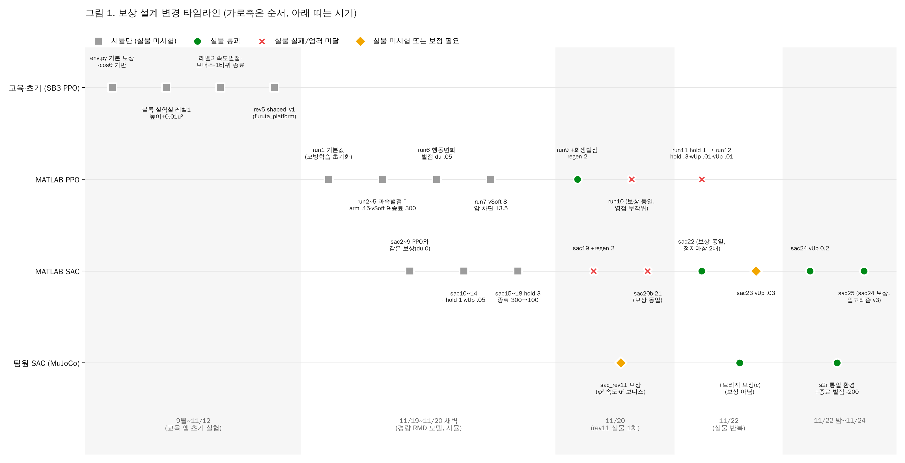
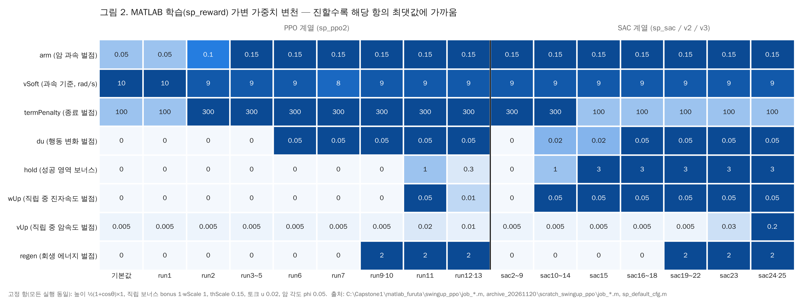

# 1. 요약

- 이 프로젝트의 보상은 **네 갈래**로 나뉜다. ① 초기·교육용 SB3 PPO 보상(9월~10월, `env.py` → RL 블록 실험실 레벨 0~3), ② MATLAB 자체 PPO(`run1~13`), ③ MATLAB 자체 SAC(`sac0~25`), ④ 팀원의 MuJoCo SAC(`sac_rev11`, `s2r`)다. ②와 ③은 같은 보상 함수 `sp_reward.m`을 쓰고 **가중치만** 실험마다 바꿨다.
- 실물 결과를 가장 크게 바꾼 보상 변경은 세 가지다.
  1. **회생 에너지 벌점 `regen 2` + 과전압 정지 시 종료 벌점** (run9, sac19, 11/20): 스윙업 중 급제동으로 RMD가 멈추던 문제를 정책이 피하게 했다. run9로 PPO 첫 실물 통과(7.57 s).
  2. **직립 중 암 속도 벌점 `vUp` 0.005 → 0.03 → 0.2** (sac23 → sac24, 11/22): 직립한 채 암이 한 방향으로 계속 도는 문제를 줄였다. sac24가 실물 6/6 통과, 최장 15.52 s로 전체 제어기 중 최선.
  3. **성공 영역 보너스 `hold` + 진자 속도 벌점 `wUp`** (SAC는 sac10부터, PPO는 run11·12): 엄격 기준(±5°, 0.5 rad/s, 5 s)을 직접 보상으로 넣었다. PPO에서는 강하게(hold 1) 넣으면 지연 강건성이 무너져 run12에서 0.3으로 낮췄다.
- sac20~22는 **보상이 sac19와 같고** 학습 환경 무작위화(영점 오차, 정지마찰)만 바뀌었다. "stic2x"는 보상이 아니라 정지마찰 무작위화 상한 0.5 → 1.0을 뜻한다. 마찬가지로 run10·run13도 보상 변경이 없다.
- 팀원 쪽의 **"브리지 보상 (c)"는 보상(reward)이 아니라 마찰·관성 보정(compensation) 토크**다. 이름 때문에 혼동되므로 보고서·발표에서 "브리지 보정"으로 표기하는 것을 권한다.

# 2. 근거 자료와 확인 방법

| 자료 | 위치 | 쓴 내용 |
|---|---|---|
| MATLAB 보상 함수 | `C:\Capstone1\matlab_furuta\swingup_ppo\sp_reward.m` | 보상 식 (모든 run·sac 공통) |
| 기본 가중치 | `swingup_ppo\sp_default_cfg.m` | `cfg.rw` 기본값 |
| 실행별 설정 | `swingup_ppo\job_run9~13.m`, `job_sac18~25.m`, `archive_20261120\scratch_swingup_ppo\job_ppo1.m`, `job_run2~8.m`, `job_sac0~17.m` | 실행마다 덮어쓴 가중치, 초기 정책, 무작위화 |
| 행동 변화·회생 벌점 적용부 | `sp_ppo2.m`, `sp_sac_v2.m` (학습 루프 안) | du·regen 항, 과전압 정지 시 종료 벌점 |
| 실행 시각 | 각 결과 폴더 `config.mat`의 생성 시각 | 날짜·시간 (한국 시간) |
| 실물 결과 | `REV11_HARDWARE_RESULTS_20261120.md`(11/20~11/23 누적), `README_인수인계.md`(11/24), `RESULTS_tables.md` | 실물 통과·실패, 원인 |
| Python 포팅 | `handoff_python_20261124.zip` 안 `train_bench_torch.py`, `init_ppo.json`, `init_sac.json`, `teammate.py` | MATLAB 보상과 같은 식의 포팅, sac24/run12 설정 확인 |
| 교육·초기 보상 | `Capstone1/Capstone1/Mujoco/files/env.py`, `rl_blocklab/templates.py`, `matlab_furuta/furuta_reward.m` | 초기 보상과 레벨 0~3 |
| 별도 파이프라인 | `C:\Capstone1\furuta_platform\rewards.py`, `configs\rev5_*.json` | rev5 baseline / shaped_v1 보상 |
| 팀원 SAC | `C:\Capstone1\furuta-pendulum-rl\rl\furuta_env.py`, `rl\train_rev11.py`, `s2r\s2r_env.py`, `s2r\README.md` | sac_rev11 보상, s2r 통일 환경 보상 |
| 서술 | `research_note/연구노트_…docx`, `final_presentation/최종발표_전체정리.md`, `report_final/실험정리_및_보고서내용.md`, `handoff_ai/HANDOFF_다른AI용.md` | 변경 이유, 교차 확인 |

**확인 방법과 한계.** 가중치는 job 스크립트의 코드에서 읽었다. 결과 폴더의 `config.mat`(바이너리)는 열어 보지 않았으므로, 스크립트가 실행 뒤에 수정됐다면 실제 값과 다를 수 있다. 특히 `sp_default_cfg.m`이 9~11월 사이에 바뀌었는지는 기록이 없다. 연구노트의 "sac24: 직립 중 암 속도 벌점 0.005 → 0.2" 서술이 현재 기본값 `vUp 0.005`와 맞으므로 큰 변경은 없었던 것으로 본다(**확인 필요**: `config.mat`의 `cfg.rw`를 MATLAB에서 출력해 대조).

# 3. 보상 식

## 3.1 MATLAB `sp_reward` (run1~13, sac0~25 공통)

기호: θ = 진자 각(직립 0), ω = 진자 각속도, v = 암 각속도, φ = 암 각, u = 정규화 지령(−1~1), n = exp(−(θ/thScale)²) (직립 근처에서만 1에 가까움).

> r = ½(1+cos θ) + bonus·n·exp(−(ω/wScale)²) − w_u·u² − arm·max(0, abs(v) − vSoft)² − phi·n·φ² − vUp·n·v²
>
>   + hold·[abs(θ) ≤ 5°, abs(ω) ≤ 0.5] − wUp·n·ω² − du·(u − u_prev)² − regen·E_regen

- 종료: |v| ≥ 암 학습 한계(기본 15 rad/s), |ω| ≥ 25 rad/s, 수치 발산, 또는 (run9·sac19 이후) 회생 에너지 예산 0.8 J 초과로 모터가 멈춘 경우. 종료 시 보상 = −termPenalty.
- `hold`, `wUp`은 선택 항(필드가 있을 때만), `du`, `regen`은 학습 루프(`sp_ppo2`, `sp_sac_v2`)에서 더한다.
- E_regen은 한 번의 연속 제동 동안 누적된 제동 에너지(J)로, 제동이 끝나면 0으로 돌아간다(`train_bench_torch.py`의 포팅 코드 기준).
- 모든 실행에서 고정: 높이 가중치 1, bonus 1, wScale 1, thScale 0.15, w_u 0.02, phi 0.05.

## 3.2 기타 보상 식

| 이름 | 식 | 출처 |
|---|---|---|
| 초기 `env.py` (SB3 PPO) | r = −cos(p) − 0.01·ω² − 0.001·v² − 0.001·u² (p=0 매달림) | `Mujoco/files/env.py` |
| 블록 실험실 레벨 1 | r = 높이 − 0.01·u² | `rl_blocklab/templates.py` |
| 블록 실험실 레벨 2·3 | r = 높이 − 0.001·ω² − 0.00002·v² − 0.01·u² + 1·[직립 오차 < 0.35 rad], 암 각 절댓값 > 2π면 종료 −50 (레벨 3은 + 도메인 무작위화) | 같음, MATLAB 포팅 `furuta_reward.m` |
| rev5 baseline | r = cos α − 0.02·θ² − 0.001·θ̇² − 0.001·α̇² − 0.01·u² | `furuta_platform/rewards.py`, `configs/rev5_baseline.json` |
| rev5 shaped_v1 | r = 1·h + 0.5·h⁴·exp(−(α̇/2)²−(θ̇/2)²) − 0.1·(암 경계)² − 0.01·u² − 0.02·(Δu)², 실패 시 매 스텝 −1 흡수 | `configs/rev5_shaped_*.json` |
| 팀원 `sac_rev11` | r = 1 − 0.3·φ² − 0.002·α̇² − 0.002·θ̇² − 0.02·u² + 0.5·exp(−(φ/0.3)²)·exp(−(α̇/2)²), 종료 벌점 없음(φ: 진자, 직립 0) | `furuta-pendulum-rl/rl/furuta_env.py` |
| 팀원 `s2r` 통일 환경 | 위 식 + 종료(암 > 1100 dps 또는 진자 > 25 rad/s) 시 −200, 선택 항 du_pen·(Δu)² | `s2r/s2r_env.py` |

# 4. 시간순 변천

## 4.1 1단계: 초기 보상과 교육용 앱 (2026-09 ~ 10-05)

| 시기 | 실험 | 보상 | 결과 | 바꾼 이유 |
|---|---|---|---|---|
| 9월 초 (텐서보드 로그 9/4, 9/29) | `Capstone1/Mujoco/files` SB3 PPO, rod 모델 | `env.py` 기본 보상 | rod 모델 체크포인트만 있음. CAD 모델로는 40만 스텝 직립 0% | 가벼운 CAD 암에 비해 암 속도 벌점이 과대 |
| 10-03 ~ 10-05 | RL 블록 실험실 레벨 1 | 높이 + 0.01·u² | 20만 스텝부터 직립 약 90% (30만 스텝 약 4.4분 88.6%) | 높이 중심으로 재설계 |
| 같음 | 레벨 2 | + 속도 벌점·직립 보너스·1바퀴 초과 종료 | 25만 스텝부터 약 88~89% | 학생이 "벌점·보너스"를 조절하는 단계 |
| 같음 | 레벨 3 | 레벨 2 + 도메인 무작위화 | 35만 스텝부터 약 90% | Sim-to-Real 실습용 |
| 같음 | 토론용 | 원래 `env.py` 보상 | 0% | 가중치를 고쳐 보는 토론 소재로 남김 |

근거: 연구노트 [04], `rl_blocklab/README.md`, 최종발표 정리 §8. 하드웨어 실물 시험은 없었다.

**곁가지 (11/12경, 확인 필요):** `C:\Capstone1\furuta_platform`(rev5 모델, 토크 0.05 N·m)에서 baseline과 shaped_v1 보상으로 balance·mixed·swingup 실험을 했다(`runs\provenance_smoke_20261112`, `balance_v1_s42` 등). 결과와 이 경로를 그만둔 이유는 문서에서 찾지 못했다.

## 4.2 2단계: MATLAB 경량 RMD 모델, 시뮬레이션만 (11-19 ~ 11-20 새벽)

에너지 스윙업(암 속도 제한) + LQR 전문가를 모방학습(BC)으로 초기화한 뒤 PPO·SAC로 미세학습했다.

| 실행 | 날짜 | 초기 정책 | 보상 변경 (기본값 대비) | 결과 (시뮬) | 이유 |
|---|---|---|---|---|---|
| run1 | 11/19 | bc_init | 기본값 그대로 (arm 0.05, vSoft 10, 종료 100, vUp 0.005) | 출발점 | |
| run2 | 11/19 | BC2(지연 2 학습) | arm 0.1, vSoft 9, 종료 300 | 확인 필요 | 과속(암 15 rad/s 인터록) 억제 |
| run3·4·5 | 11/19 (run4 20:30) | run1 ck_0260 | arm 0.15, vSoft 9, 종료 300 | run4(30 ms 필터) 무작위 119/120, run5 fixed 3/3 | README: "과속 벌점 강화(vSoft 9, termPenalty 300)" |
| run6 | 11/19 | run4 ck_0270 | + du 0.05 (행동 변화 벌점) | fixed MIL 3/3, 무작위 9/10, 배치 116/120 | 지연 10~20 ms 무작위화와 함께 직립 진동(±1.2 A 떨림) 억제 |
| run7 | 11/19 (22:00) | run6 ck_0250 | vSoft 8, 학습용 암 차단 13.5 rad/s | fixed 12/13, 배치 120/120 → **최종 후보** | 실물 인터록 15 rad/s에 여유 확보 |
| run8 | 11/19 | run7 ck_0250 | run7과 같음, 2 A 스케일 | 암 16.8 rad/s로 인터록 초과 → 폐기 | 전류 스케일 시험 (보상 변경 아님) |
| sac0·sac2~4, 6~9 | 11/19~20 | bc_init / sac3 | PPO run3와 같은 과속 벌점, **du 0** (sac0만 vSoft 8·du 0.05) | sac3 실제 상태 16/16, 필터 관측 0~2/16 | 알고리즘 문제(BC 정규화, n-step, 비대칭 비평가) 탐색, 보상은 고정 |
| sac5 | 11/19~20 | PPO run7 | run7과 같음 (vSoft 8, du 0.05, 암 13.5) | 16 → 12~13/16 하락 | PPO 정책을 SAC 초기값으로 |
| sac10~14 | 11/19~20 | sac3 / bc | **+ hold 1.0, wUp 0.05**, du 0.02 | 0~2/16 (sac12: 직립 영역 체류 93%, 5 s 연속 실패) | SAC가 직립 근처에서 떠는 문제 → 엄격 기준을 보상에 직접 반영 |
| sac15 | 11/20 01:15 | bc_init (정규화 없음) | **hold 3.0**, 종료 **300 → 100**, du 0.02 | 확인 필요 (sac16 출발점 ck_0100) | 문헌식 SAC(v2) 도입과 함께 보너스 강화. 종료 벌점을 낮춘 이유는 문서에 없음 (확인 필요) |
| sac16·17·18 | 11/20 (sac18 03:32) | sac15 → 16 → 18 | du 0.05 (sac17: 암 14, 진자 23.5 학습 차단) | sac16 ck_0200 MIL 13/13, sac18 ck_0450 5조건 123/123 | 지연 분수 무작위화(sac16), 필터 시상수 0~30 ms 무작위화(sac18) |

## 4.3 3단계: rev11 실물 1차 (11-20)

11/20부터 학습 플랜트를 rev11 실측 식별값(`rev11_ident_config`)으로 바꿨다. PID 실물 시험에서 **고속 반전 제동 시 회생 과전압으로 RMD가 응답을 멈추는 현상**이 확인돼, 학습 환경에 "연속 제동 에너지 0.8 J 초과 시 모터 정지(종료)" 모델을 넣고 보상에 회생 벌점을 더했다.

| 실행 | 시각 | 초기 정책 | 보상 변경 | 실물 결과 | 이유·해석 |
|---|---|---|---|---|---|
| **run9_rev11_regen** | 11/20 16:36 | run7 ck_0250 | vSoft 9로 복귀, **+ regen 2**, 과전압 정지 = 종료 −300 | ppo_rev11_12: 9.3 s 유지 후 CAN 누락 정지 → ppo_rev11_tol2_13 **통과 7.57 s**, 최대 0.87 A, 포화 0% | 회생 과전압 대응. PPO 첫 실물 통과 |
| sac19_rev11_regen | 11/20 16:55 | sac18 ck_0450 | **+ regen 2** (hold 3, wUp 0.05, du 0.05, 종료 100 유지) | sac_rev11_tol2_15 **실패**, 최장 0.77 s, 도립 4회 모두 암이 한쪽으로 가속(최대 11.5 rad/s) | 원인: 영점 ±2° 어긋나면 시뮬에서도 유지 실패 (보상이 아니라 모델 차이) |
| run10_rev11_bias | 11/20 | run9 ck_0380 | **변경 없음** | tol2_16 4.1 s 정지(디코더), tol2b_18 3.1 s 정지(Pi 순간 정지), tol2b_19 20 s 유지·엄격 3.04 s | 영점 ±3°, 베어링 마찰 무작위화만 추가 |
| sac20 / sac20b | 11/20 | sac19 | **변경 없음** | sac20b: 0.15 A만 출력, 정지마찰 못 넘어 출발 못 함 | 영점·베어링 마찰 무작위화 |
| sac21_rev11_stiction | 11/20 | sac19 계열 | **변경 없음** | 실패: 8.5 s 정지 후 출발, 16.8 s 진자 25 rad/s 한계 | 암 정지마찰 +0~50% 무작위화, 바닥 정지 출발 추가 |

## 4.4 4단계: 직립 품질 개선 (11-22)

11/22 반복 시험에서 PPO run10은 20 s 유지는 되지만 0.7~1 Hz의 느린 흔들림으로 진자 속도가 0.5~0.74 rad/s로 튀어 엄격 기준을 못 넘었다.

| 실행 | 시각 | 초기 정책 | 보상 변경 | 결과 | 이유·해석 |
|---|---|---|---|---|---|
| run11_rev11_hold | 11/22 17:52 | run10 ck_0250 | **+ hold 1.0, wUp 0.05, vUp 0.005 → 0.02** | 실물 미시험. 시뮬에서 지연 강건성 상실 | 흔들림 억제 목적. job_run12 주석: "lowered after run11 lost delay robustness" |
| **run12_rev11_hold_lo** | 11/22 | run10 ck_0250 | **hold 0.3, wUp 0.01, vUp 0.01** (낮춤) | 실물 20 s 유지 3/3, 엄격 1/3 (ppoc_36 8.07 s) | 지연 10 ms 14/16, 15~20 ms 0/16 악화(run11도 같음 → 보상보다 새 학습 조건 영향으로 추정) |
| run13_rev11_delay | 11/22 | run12 ck_0300 | **변경 없음** | 개선 없음, 실물 미시험 | 지연 10~20 ms 정수 무작위화. PPO 과제는 지연이 아니라 직립 중 미세 흔들림으로 결론 |
| **sac22_rev11_stic2x** | 11/22 | sac21 ck_0100 | **변경 없음** (sac19와 같은 보상) | ck_0150 **실물 3/3 통과** (14.78 / 6.20 / 12.77 s). 단 직립 중 암이 계속 회전(누적 최대 −4129°). ck_0400은 시뮬 25/25인데 실물 0/3 | 정지마찰 무작위화 상한 0.5 → 1.0("2배"). 첫 SAC 실물 통과 |
| sac23_rev11_armrate | 11/22 21:43 | sac22 계열 (확인 필요) | **vUp 0.005 → 0.03** | 시뮬 암 회전 1115° → 892°, 효과 미미. 실물 미시험 | sac22의 "직립 중 암 회전"을 보상으로 억제 시도 |
| **sac24_rev11_armrate2** | 11/22 22:31 | sac23 ck_0200 (실험 결과 md 기준) | **vUp 0.2** | ck_0100 **3/3** (11.52 / 14.86 / 15.52 s), ck_0200 **3/3** → 누적 **6/6**, 넘어짐 없음, 최대 오차 1.67~2.11° | job_sac24 주석: "vUp 0.03 barely reduced the arm spin, try 0.2". 시뮬 직립 중 암 회전 평균 715°(sac22 ck_0400 1163°) |

## 4.5 5단계: 알고리즘 안정화와 Python 이관 (11-23 ~ 11-24)

| 실행 | 날짜 | 보상 | 결과 | 비고 |
|---|---|---|---|---|
| sac25_v3_opt | 11/23 | **sac24 설정 그대로** (config.mat를 불러와 사용) | 실물 ck_0150 2/3 (7.12 / 9.68 s, 1회는 Pi 정지) | 바뀐 것은 SAC v3 안정화(통합 쌍둥이 비평가, LayerNorm, 타깃 2회마다, 그래디언트 제한 10) |
| PPO 벤치 (`job_ppobench`) | 11/23 | run12 설정 | 학습률 감쇠·그래디언트 제한은 차이 없음 → 미채택 | |
| Python 포팅 (`train_bench_torch.py`) | 11/24 | `reward()` = `sp_reward` 포팅, `RW` = sac24 가중치, PPO는 run12 값으로 덮어씀 | 처음부터 25분 학습: PPO 성공 11~13분, SAC 실패 | 보상 변경 없음 |

## 4.6 팀원 SAC 갈래 (MuJoCo, 50 Hz)

| 단계 | 날짜 | 보상 | 결과 | 비고 |
|---|---|---|---|---|
| `sac_rev11` 학습 | 확인 필요 (11/20 이전) | 3.2절 팀원 식 (높이 대신 −0.3·φ², 직립 보너스 0.5, 종료 벌점 없음) | 정책 단독 0/128 (s2r 평가) | `train_rev11.py`: "보상·관측·종료는 벤치마크와 같다" |
| + 브리지 보정 (c) | 11/20 자료, 11/23 실물 | **보상 변경 없음.** Pi 쪽 토크 보정 τ = s·τ_pol + 마찰 차이 + 점성 차이, 1.2 A, 제동 5 W | 실물 3/3 (7.50 / 6.72 / 8.32 s, 20 ms 샘플 기준) | "보정을 빼면 0/16" |
| `s2r` 통일 환경 | 11/24 | 팀원 식 + **종료 벌점 −200** | SAC 시드 3개 실물 15/15, PPO s2 5/5 | 종료 벌점 이유: "팔·진자 속도 한계로 끝나는 쪽이 이득이 되지 않게" |
| 앱 '따라 하기' / 4단계 떨림 | 11/25 | `w_smooth`, `w_effort` 옵션, `du_pen` 옵션 추가 (기본값은 1단계와 같음) | 아홉 칸 정책 128칸 119~128 | 교육 앱(Pendulum Studio)용 |

# 5. 항목별로 본 변천

| 보상 항 | 처음 | 변경 경로 | 계기 |
|---|---|---|---|
| 암 과속 벌점 arm / vSoft | 0.05 / 10 | run2 0.1/9 → run3 0.15/9 → run7 0.15/8 → run9부터 0.15/9 고정 | 실물 인터록(암 15 rad/s)에 걸리지 않게 |
| 종료 벌점 | 100 | PPO run2부터 300 고정. SAC는 sac0~14 300 → sac15부터 100 | PPO는 인터록 회피 강화. SAC를 100으로 낮춘 이유는 기록 없음 (확인 필요) |
| 행동 변화 벌점 du | 0 | PPO run6 0.05. SAC 0 → sac10 0.02 → sac16 0.05 | 지연 무작위화와 함께 직립 중 지령 떨림 억제 |
| 성공 영역 보너스 hold | 없음 | SAC sac10 1.0 → sac15 3.0. PPO run11 1.0 → run12 0.3 | 엄격 기준(±5°, 0.5 rad/s)을 보상으로. PPO는 강하면 지연 강건성 하락 |
| 직립 중 진자 속도 벌점 wUp | 없음 | SAC sac10부터 0.05. PPO run11 0.05 → run12 0.01 | 같음 |
| 직립 중 암 속도 벌점 vUp | 0.005 | SAC sac23 0.03 → sac24 0.2. PPO run11 0.02 → run12 0.01 | sac22 실물에서 암 계속 회전 |
| 회생 벌점 regen | 없음 | run9·sac19부터 2, 과전압 정지 = 종료 | 11/20 PID 실물에서 회생 과전압 정지 확인 |

# 6. 해석: 무엇이 실물 결과를 바꿨나

1. **보상을 바꾼 경우와 환경을 바꾼 경우를 나눠 봐야 한다.** sac19 → sac22의 실패 → 통과는 보상이 아니라 학습 환경(영점 오차, 정지마찰 2배, 바닥 정지 출발)의 변화였다. 반면 sac22 → sac24의 "암 계속 회전" 해소는 보상 변경(vUp)이었다.
2. **실물에서 본 증상을 보상 항 하나에 대응시킨 변경이 효과가 컸다.** 회생 정지 → regen 항, 암 회전 → vUp, 엄격 기준 미달 → hold·wUp. 교육 앱의 "보상 설계 → 관찰 → 수정" 순환과 같은 구조라 수업 사례로 쓸 수 있다.
3. **가중치의 크기가 중요했다.** vUp 0.03은 효과가 미미했고 0.2에서 효과가 났다. PPO의 hold는 1.0에서 부작용(지연 강건성 하락), 0.3에서 절충됐다.
4. **시뮬 점수로 고른 체크포인트가 실물에서 뒤집혔다**(sac22 ck_0400: 시뮬 25/25, 실물 0/3). 보상 설계 평가는 실물 반복 시험으로 끝내야 한다.

# 7. 문서 간 불일치와 확인 필요 항목

| 번호 | 내용 | 판단 |
|---|---|---|
| D1 | 연구노트: "sac24: 직립 중 암 속도 벌점 0.005 → 0.2" | 실제로는 sac23에서 0.03을 먼저 시도했다. 연구노트에 sac23을 추가하는 것이 정확하다 |
| D2 | `init_sac.json`의 `init` 문자열 "sac19_rev11_regen/ck_0200 + …" | job_sac20~24가 같은 문자열 틀을 재사용한 흔적. sac24의 실제 초기 정책은 실험 결과 md 기준 sac23 ck_0200 |
| D3 | "브리지 보상 (c)" 표기 | 보상(reward)이 아니라 보정(compensation). 발표·보고서에서 "브리지 보정"으로 바꾸기를 권함 |
| D4 | 인수인계 README "init_sac.json: sac19 ck_0150 출발점" vs json `init` 문자열 ck_0200 | 벤치마크 시작점은 stability.py 주석과 같이 sac19 ck_0150 actor로 보임 (확인 필요) |
| D5 | "stic2x" | 보상 변경이 아니라 정지마찰 무작위화 상한 0.5 → 1.0 |
| 확인 필요 | sp_default_cfg가 9~11월 사이 바뀌었는지, run2·sac15 결과, SAC 종료 벌점을 100으로 낮춘 이유, 팀원 sac_rev11 학습 날짜, rev5 furuta_platform 실험의 결과와 중단 이유 | `config.mat`·학습 로그 대조 필요 |

# 부록 A. 실행별 전체 가중치 (MATLAB `cfg.rw`)

고정: 높이 1, bonus 1, wScale 1, thScale 0.15, u 0.02, phi 0.05. "-"는 해당 항 없음.

| 실행 | arm | vSoft | 종료 | du | hold | wUp | vUp | regen | 학습 암 차단 | 알고리즘 |
|---|---|---|---|---|---|---|---|---|---|---|
| 기본값 | 0.05 | 10 | 100 | - | - | - | 0.005 | - | 15 | |
| run1 | 0.05 | 10 | 100 | - | - | - | 0.005 | - | 15 | sp_ppo |
| run2 | 0.10 | 9 | 300 | - | - | - | 0.005 | - | 15 | sp_ppo2 |
| run3·4·5 | 0.15 | 9 | 300 | - | - | - | 0.005 | - | 15 | sp_ppo2 |
| run6 | 0.15 | 9 | 300 | 0.05 | - | - | 0.005 | - | 15 | sp_ppo2 |
| run7·8 | 0.15 | 8 | 300 | 0.05 | - | - | 0.005 | - | 13.5 | sp_ppo2 |
| run9·10 | 0.15 | 9 | 300 | 0.05 | - | - | 0.005 | 2 | 15 | sp_ppo2 |
| run11 | 0.15 | 9 | 300 | 0.05 | 1.0 | 0.05 | 0.02 | 2 | 15 | sp_ppo2 |
| run12·13 | 0.15 | 9 | 300 | 0.05 | 0.3 | 0.01 | 0.01 | 2 | 15 | sp_ppo2 |
| sac0 | 0.15 | 8 | 300 | 0.05 | - | - | 0.005 | - | 13.5 | sp_sac |
| sac2·3·4·6·7·8·9 | 0.15 | 9 | 300 | 0 | - | - | 0.005 | - | 15 | sp_sac / asym |
| sac5 | 0.15 | 8 | 300 | 0.05 | - | - | 0.005 | - | 13.5 | sp_sac |
| sac10~14 | 0.15 | 9 | 300 | 0.02 | 1.0 | 0.05 | 0.005 | - | 15 | asym / hist |
| sac15 | 0.15 | 9 | 100 | 0.02 | 3.0 | 0.05 | 0.005 | - | 15 | sp_sac_v2 |
| sac16·18 | 0.15 | 9 | 100 | 0.05 | 3.0 | 0.05 | 0.005 | - | 15 | sp_sac_v2 |
| sac17 | 0.15 | 9 | 100 | 0.05 | 3.0 | 0.05 | 0.005 | - | 14 (진자 23.5) | sp_sac_v2 |
| sac19~22 | 0.15 | 9 | 100 | 0.05 | 3.0 | 0.05 | 0.005 | 2 | 15 | sp_sac_v2 |
| sac23 | 0.15 | 9 | 100 | 0.05 | 3.0 | 0.05 | 0.03 | 2 | 15 | sp_sac_v2 |
| sac24 | 0.15 | 9 | 100 | 0.05 | 3.0 | 0.05 | 0.2 | 2 | 15 | sp_sac_v2 |
| sac25 | 0.15 | 9 | 100 | 0.05 | 3.0 | 0.05 | 0.2 | 2 | 15 | sp_sac_v3 |

# 부록 B. 학습 환경(도메인 무작위화) 변천 — 보상과 구분하기 위해

| 실행 | 추가된 무작위화 |
|---|---|
| run4 / sac4 | 30 ms 필터 관측 |
| run6 / sac16 | 지연 분수(10~20 ms) |
| sac11 / sac18 | 필터 시상수 0~30 ms |
| run9 / sac19 | rev11 식별 플랜트, 회생 예산 0.8 J |
| run10 / sac20 | 진자 영점 ±3°, 진자 베어링 마찰 0~1e-3 N·m |
| sac21 / run11·12 | 암 정지마찰 +0~50%, 바닥 정지 출발(mix 5번째), (PPO) 베어링 마찰 0~2e-3 |
| sac22~25 | 암 정지마찰 +0~100% |
| run13 | 정수 지연 10~20 ms |
