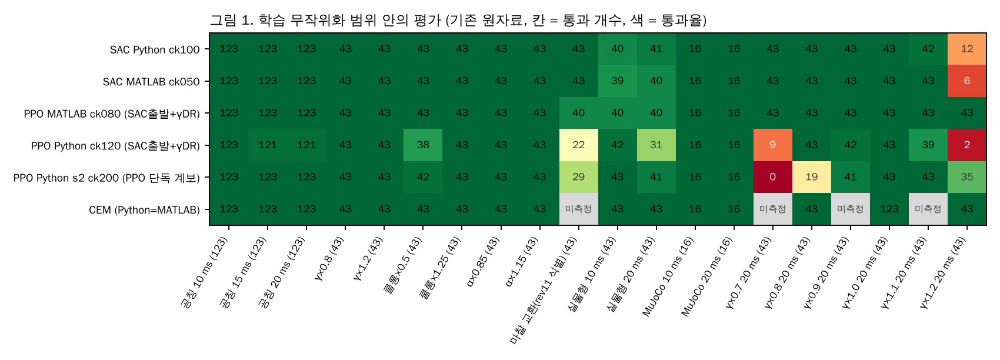
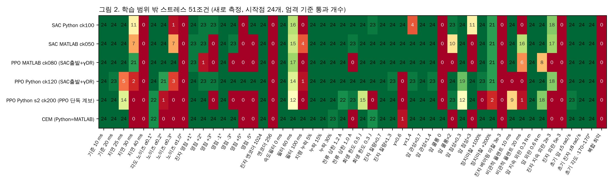
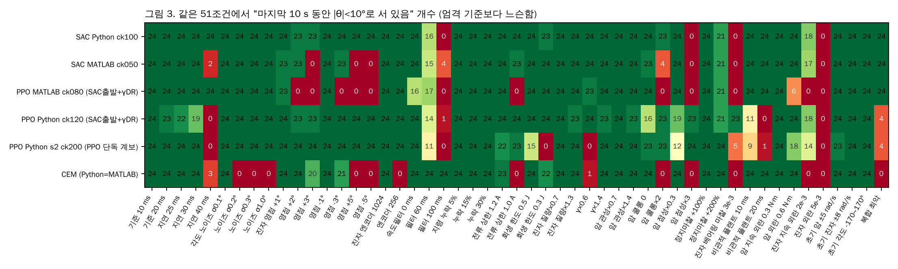
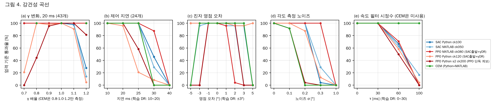
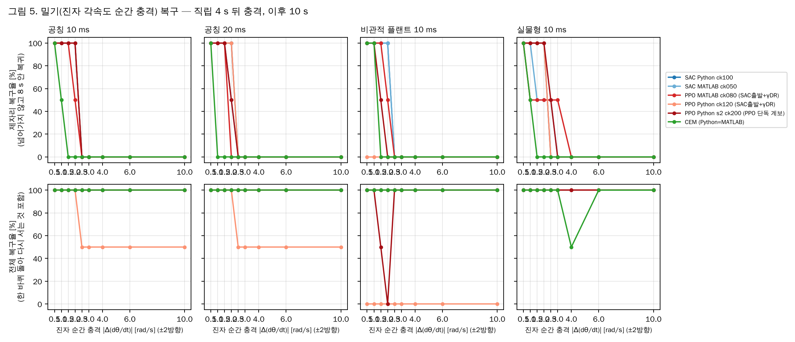
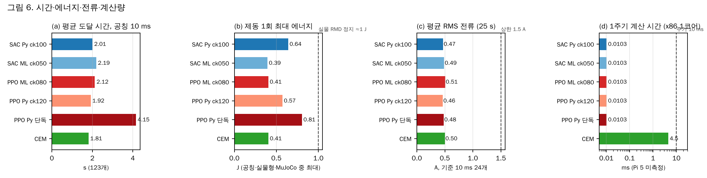
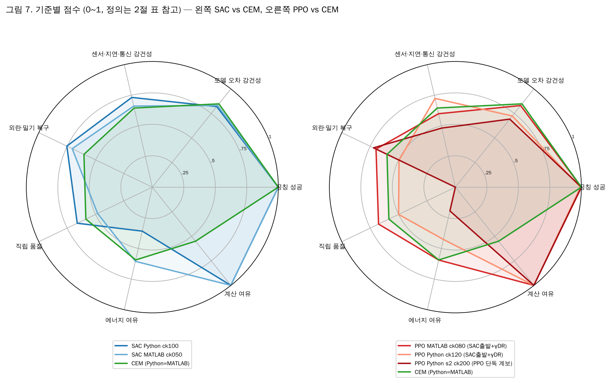

# rev22 제어 정책 비교·선정 근거: SAC · PPO · CEM (2026-11-28)

확인 범위: **PC 시뮬레이션만**. rev22 실물, Pi 5, Simscape에서는 아무것도 돌리지 않았다. rev22 질량·관성은 STEP 형상에 밀도를 가정한 값이다(진자 39.2 g, 실측 아님).

## 0. 결론 먼저

| 환경 | 추천 | 근거 (이 보고서의 수치) |
|---|---|---|
| rev22 실물 첫 시험 (영점·γ 미측정) | **SAC Python ck100** | 스트레스 51조건 엄격 통과 합계 1위(엄격 894 (1107)/1224), 영점 ±3° 모두 통과, 제자리 밀기 복구 상위(진자 2 rad/s·암 4~8 rad/s), 전류 1.0 A에서도 통과, 계산 0.01 ms |
| 공칭 rev22, 지연 10~20 ms | PPO MATLAB ck080 또는 SAC (모두 100%) | 통과율로는 차이 없음. 직립 떨림이 가장 작은 것은 PPO MATLAB ck080(진자 속도 최대 0.16/0.21 rad/s), 제동 에너지는 SAC MATLAB ck050·PPO MATLAB ck080이 0.4 J로 가장 작음 |
| γ(결합항)가 CAD와 크게 다를 때 | **PPO MATLAB ck080** | γ×0.6~1.4 전부 통과, γ×0.7~1.2 20 ms 모두 43/43. 학습 때 γ를 ±20% 무작위화한 유일한 정책 |
| 지연이 20 ms를 넘을 때 (25~30 ms) | **PPO MATLAB ck080** | 30 ms에서 21/24 (SAC 7~11, CEM 0). 40 ms는 모두 실패 |
| 각도 노이즈가 클 때 (σ 0.2~0.3°) | **PPO MATLAB ck080** | σ0.3°에서 24/24, 나머지 0~7. σ0.2°는 SAC 둘·PPO MATLAB 24/24, CEM 0 |
| 비관적 플랜트(γ×0.8 + rev11 식별 마찰) + 20 ms | **CEM** | 24/24. SAC MATLAB 16, PPO MATLAB 6, SAC Python 0 |
| 마찰이 측정값보다 훨씬 작을 때 / 정지마찰이 클 때 | **CEM** | 암 쿨롱 0: CEM 24/24, RL 전부 0 (서 있지만 떨림). 정지마찰 +200%: CEM 24, RL 21 |
| 마찰·점성이 측정값보다 클 때, 전류 상한이 낮을 때 | **SAC Python ck100** (또는 PPO Python ck120) | 쿨롱×2 23/24, 점성×3·전류 1.0 A 통과. CEM·PPO MATLAB은 0 |
| 진자 영점이 틀어져 있을 때 | **SAC Python ck100 / PPO Python ck120** | 영점 −5~+5°에서 PPO Python ck120은 전부 통과, SAC Python ck100은 −5~+3° 통과(+5°는 서 있지만 떨림). SAC MATLAB은 +3°, PPO MATLAB은 +2°·−3°에서 넘어짐. CEM은 ±3° 통과, ±5° 넘어짐 |
| 사람이 밀거나 툭 칠 때 | **SAC Python ck100** (PPO MATLAB ck080 근소 차) | 제자리 복구 한계 진자 2 rad/s, 연속 밀기 직립 80%. CEM은 0.5 rad/s만 넘어도 한 바퀴 돌고 다시 선다(복구는 100%, 약 1 s) |
| 교실·교육용 시연 | SAC Python ck100 + 학습 과정 설명은 PPO | PPO는 rev22에서 처음부터 학습하면 서지 못했다(1000회 0/16). 지금 PPO는 "SAC로 찾고 PPO로 다듬은" 정책 |

- 한 정책이 모든 환경에서 이기지 않는다. 약점이 서로 겹치지 않는다.
  - SAC는 γ가 커질 때(γ×1.2·20 ms, γ×1.4)와 노이즈에 약하다.
  - PPO MATLAB은 진자 영점 오차(+2°, −3°에서 넘어짐), 전류 1.0 A, 진자 지속 외란에 약하다.
  - CEM은 각도 노이즈(σ0.2°부터 넘어짐, σ0.1°는 22/24), 마찰 증가, 전류 1.0 A, 제자리 밀기에 약하고 계산이 무겁다.
- **실물에서 가장 먼저 잴 것**은 진자 영점, γ(진자 질량·주기), 노이즈 크기다. 이 세 값이 정해지면 위 표에서 바로 고를 수 있다.
- PPO Python s2 ck200(PPO 단독 계보)은 모든 축에서 다른 정책보다 낮아 후보에서 뺀다. 비교선으로만 남긴다.

## 1. 비교 대상

| 이름 | 파일 | 학습 | 비고 |
|---|---|---|---|
| SAC Python ck100 | `rev22_sac_python_ck0100.npz` | Python SAC 100회, rev11 sac24 actor 출발 | 앞 보고서 1순위 |
| SAC MATLAB ck050 | `rev22_sac_matlab_ck0050.npz` | MATLAB `sp_sac_v3` 50회 | MATLAB→Pi 코드 생성 경로 |
| PPO MATLAB ck080 | `rev22_ppo_matlab_sacinitg_ck0080.npz` | SAC ck050 가중치 출발 + PPO 80회 + γ ±20% 무작위화 | `REV22_PPO_세우기.md` PPO 1순위 |
| PPO Python ck120 | `rev22_ppo_python_sacinitg_ck0120.npz` | SAC ck100 출발 + PPO 120회 + γ 무작위화 | Python PPO 최선 |
| PPO Python s2 ck200 | `rev22_ppo_python_rwdef_s2_ck0200.npz` | rev11 run10 정책에서 PPO만으로 이어 학습 | PPO 단독 계보 비교선 |
| CEM | `rev22_control/cem/` (`cem_final.json`) | 학습 없음. 샘플링 MPC, 설계 모델 γ×0.9 + 식별 마찰 | MATLAB 판은 Octave에서 Python과 지령 600개가 정확히 같음을 확인. 그래서 한 번만 평가했다 |

모든 정책은 같은 플랜트 시뮬레이터(`xcheck.PiEnv` 의미론: 0.01 A 양자화, ±1.5 A, 지연 큐, 12비트 진자 엔코더, 30 ms 속도 필터, 회생 한도)에서 같은 시작점으로 돌렸다. 새 시험의 하네스는 기존 평가를 그대로 재현한다(실물형 10 ms: SAC Python 40/43, PPO MATLAB 40/43, CEM 43/43, 기존 보고서와 같음).

## 2. 평가 근거(지표)와 정의

| 기준 | 지표 | 정의 | 출처 |
|---|---|---|---|
| 1. 성공률 | 조건별 엄격 기준 통과 수 | 20 s 안에 도달, ±5°·±0.5 rad/s를 5 s 유지, 암 15·진자 25 rad/s 미만 | 기존 평가 + 새 스트레스 시험 |
| 1-보조 | "서 있음" 수 | 마지막 10 s 동안 \|θ\|<10°. 엄격 기준 실패가 "넘어짐"인지 "떨림"인지 가른다 | 새 시험 |
| 2. 도달 시간 | 평균 도달 시간 | 통과한 런의 도달 시각 평균 | 기존 json |
| 3. 직립 품질 | 직립 중 진자 속도 최대, RMS 각도 | 마지막 10 s 진자 속도 최댓값의 런 평균, 직립 구간 RMS | 새 시험, 기존 json |
| 4. 전류·포화 | ±1.5 A 포화율, RMS 전류, 전류 상한 1.2/1.0 A 시험 | | 기존 json + 새 시험 |
| 5. 회생 에너지 | 제동 1회 최대 에너지 | 연속 제동 구간의 −τ·φ̇ 적분 최댓값. 실물 RMD가 멈춘 기준 약 1 J | 기존 json + 새 시험 |
| 6. 모델 오차 강건성 | γ, 쿨롱, 점성, 정지마찰, α, 진자 질량·마찰 변화 통과율 | 학습 무작위화 밖(γ×0.6·1.4, 쿨롱 0·×2, 점성×0.3·×3, 정지마찰 +200%, 질량 ±30%) 포함 | 기존 + 새 시험 |
| 7. 센서·지연·통신 강건성 | 지연 25~40 ms, 노이즈 σ, 영점, 엔코더 분해능, 필터 τ, 지령 누락 | | 새 시험 |
| 8. 외란·복구 | 밀기 복구율, 제자리 복구 한계, 복구 시간, 연속 밀기 직립 비율 | 4절 정의 | 새 시험 |
| 9. 계산 시간 | 1주기 계산 시간 | x86 1코어에서 측정. **Pi 5는 미측정** | CEM 보고서 4.5 ms, MLP는 이번에 측정 |
| 10. 구현·검증 상태 | Pi 코드 경로, 실물 실행 여부 | 6절 | 문서 |

그림 7의 점수(0~1)는 이렇게 만들었다. 각 묶음 안 조건 통과율의 평균이다(미측정 칸은 빼고 평균).
- 공칭 성공: 공칭 10/15/20 ms + MuJoCo 10/20 ms
- 모델 오차 강건성: 기존 플랜트 변경 9개 + γ 스윕 6개 + 새 플랜트 13개 + 비관적 플랜트 2개
- 센서·지연·통신 강건성: 새 시험의 지연·센서·통신·전원 묶음
- 외란·밀기 복구: 4개 밀기 조건의 (전체 복구율 + 제자리 복구율)/2와 연속 밀기 직립 비율의 평균
- 직립 품질: 1 − (기준 10 ms 직립 진자 속도 최대 / 0.5)
- 에너지 여유: 1 − (제동 1회 최대 / 1 J)
- 계산 여유: 1 − (계산 시간 / 10 ms)

## 3. 학습 범위 안의 평가 (기존 원자료)

원자료: `REV22_PPO_SAC_결과.md`·`REV22_PPO_세우기.md`의 `results/eval_*.json`, `gam_sweep.json`, CEM은 `cem/results/vx_cem_nom_by_ident09.json`. 표의 숫자는 json에서 직접 읽었다.

| 조건 (개수) | SAC Python ck100 | SAC MATLAB ck050 | PPO MATLAB ck080 (SAC출발+γDR) | PPO Python ck120 (SAC출발+γDR) | PPO Python s2 ck200 (PPO 단독 계보) | CEM (Python=MATLAB) |
|---|---|---|---|---|---|---|
| 공칭 10 ms (123) | 123/123 | 123/123 | 123/123 | 123/123 | 123/123 | 123/123 |
| 공칭 15 ms (123) | 123/123 | 123/123 | 123/123 | 121/123 | 123/123 | 123/123 |
| 공칭 20 ms (123) | 123/123 | 123/123 | 123/123 | 121/123 | 123/123 | 123/123 |
| γ×0.8 (43) | 43/43 | 43/43 | 43/43 | 43/43 | 43/43 | 43/43 |
| γ×1.2 (43) | 43/43 | 43/43 | 43/43 | 43/43 | 43/43 | 43/43 |
| 쿨롱×0.5 (43) | 43/43 | 43/43 | 43/43 | 38/43 | 42/43 | 43/43 |
| 쿨롱×1.25 (43) | 43/43 | 43/43 | 43/43 | 43/43 | 43/43 | 43/43 |
| α×0.85 (43) | 43/43 | 43/43 | 43/43 | 43/43 | 43/43 | 43/43 |
| α×1.15 (43) | 43/43 | 43/43 | 43/43 | 43/43 | 43/43 | 43/43 |
| 마찰 교환(rev11 식별) (43) | 43/43 | 43/43 | 40/43 | 22/43 | 29/43 | 미측정 |
| 실물형 10 ms (43) | 40/43 | 39/43 | 40/43 | 42/43 | 43/43 | 43/43 |
| 실물형 20 ms (43) | 41/43 | 40/43 | 40/43 | 31/43 | 41/43 | 43/43 |
| MuJoCo 10 ms (16) | 16/16 | 16/16 | 16/16 | 16/16 | 16/16 | 16/16 |
| MuJoCo 20 ms (16) | 16/16 | 16/16 | 16/16 | 16/16 | 16/16 | 16/16 |
| γ×0.7, 20 ms (43) | 43/43 | 43/43 | 43/43 | 9/43 | 0/43 | 미측정 |
| γ×0.8, 20 ms (43) | 43/43 | 43/43 | 43/43 | 43/43 | 19/43 | 43/43 |
| γ×0.9, 20 ms (43) | 43/43 | 43/43 | 43/43 | 42/43 | 41/43 | 미측정 |
| γ×1.0, 20 ms (43) | 43/43 | 43/43 | 43/43 | 43/43 | 43/43 | 123/123 |
| γ×1.1, 20 ms (43) | 42/43 | 43/43 | 43/43 | 39/43 | 43/43 | 미측정 |
| γ×1.2, 20 ms (43) | 12/43 | 6/43 | 43/43 | 2/43 | 35/43 | 43/43 |

- 이 범위에서는 SAC 두 개, PPO MATLAB, CEM이 거의 같다. 차이는 마찰 교환과 γ 스윕 20 ms에서만 난다.
- CEM의 "마찰 교환"과 γ×0.7·0.9·1.1 칸은 측정하지 않았다(**미측정**). 대신 CEM은 비관적 플랜트(γ×0.8 + 식별 마찰)를 따로 평가했다(새 시험 비관적 플랜트 행, CEM 보고서 2절).
- 평가 조건 차이: RL은 회생 한도 0.8 J를 켜고, CEM 기존 평가는 끄고 돌렸다. CEM 보고서에서 한도를 켠 20 ms도 123/123이었다. 새 스트레스 시험은 모두 0.8 J 한도를 켰다.

## 4. 학습 범위 밖 스트레스 시험 (새로 측정)

조건: rev22 공칭 플랜트(11/23 마찰, γ CAD), 지연 10 ms 기준에서 한 가지씩 바꿨다. 시작점 24개(고정 3개 + 무작위 21개, 시드 2001), 25 s, 회생 한도 0.8 J.

| 묶음 | 바꾼 것 | 학습 때 무작위화 범위 |
|---|---|---|
| 지연 | 25, 30, 40 ms | 10~20 ms |
| 센서 | 각도 노이즈 σ 0.1~1.0°(암·진자 둘 다), 진자 영점 −5~+5°, 진자 엔코더 1024/256카운트, 속도 필터 τ 0/60/100 ms | 노이즈 없음, 영점 ±3°, 4096카운트, τ 0~30 ms |
| 통신 | 지령 누락 5/15/30% (이전 지령 유지, CAN 응답 누락 흉내) | 없음 |
| 전원 | 전류 상한 1.2/1.0 A, 회생 한도 0.5/0.3 J | 1.5 A, 0.8 J |
| 플랜트 | 진자 질량 ×0.7/×1.3, γ×0.6/×1.4, 암 관성 ×0.7/×1.4, 암 쿨롱 0/×2, 점성 ×0.3/×3, 정지마찰 +100/+200%, 진자 베어링 마찰 3e-3 N·m | α ±15%, 쿨롱 ±25%, 점성 ±30%, 정지마찰 +50~100% |
| 비관적 플랜트 | γ×0.8 + rev11 식별 마찰(0.40/0.12, α 0.0224), 10/20 ms | — |
| 지속 외란 | 암에 일정 토크 0.3/0.6 N·m, 진자에 2e-3/5e-3 N·m | 없음 |
| 초기 상태 | 암 ±5 rad/s, 진자 ±8 rad/s로 시작, 시작각 −170~170° 고르게 | 매달림 근처 |
| 복합 최악 | 비관적 플랜트 + 20 ms + 노이즈 0.3° + 정지마찰 +50% + 진자 마찰 1e-3 + 영점 1° + 누락 5% | — |

칸 형식: 엄격 통과 수 (마지막 10 s 서 있음 수), 24개 중.

| 묶음 | 조건 | SAC Python ck100 | SAC MATLAB ck050 | PPO MATLAB ck080 (SAC출발+γDR) | PPO Python ck120 (SAC출발+γDR) | PPO Python s2 ck200 (PPO 단독 계보) | CEM (Python=MATLAB) |
|---|---|---|---|---|---|---|---|
| 기준 | 기준 10 ms | 24 (24) | 24 (24) | 24 (24) | 24 (24) | 24 (24) | 24 (24) |
| 기준 | 기준 20 ms | 24 (24) | 24 (24) | 24 (24) | 23 (23) | 24 (24) | 24 (24) |
| 지연(DR 밖) | 지연 25 ms | 24 (24) | 24 (24) | 24 (24) | 5 (22) | 14 (24) | 24 (24) |
| 지연(DR 밖) | 지연 30 ms | 11 (24) | 7 (24) | 21 (24) | 2 (19) | 0 (24) | 0 (24) |
| 지연(DR 밖) | 지연 40 ms | 0 (24) | 0 (2) | 0 (24) | 0 (0) | 0 (0) | 0 (3) |
| 센서 | 각도 노이즈 σ0.1° | 24 (24) | 24 (24) | 24 (24) | 24 (24) | 22 (24) | 22 (24) |
| 센서 | 노이즈 σ0.2° | 24 (24) | 24 (24) | 24 (24) | 21 (24) | 1 (24) | 0 (0) |
| 센서 | 노이즈 σ0.3° | 1 (24) | 7 (24) | 24 (24) | 3 (24) | 0 (24) | 0 (0) |
| 센서 | 노이즈 σ1.0° | 0 (24) | 0 (24) | 0 (24) | 0 (24) | 0 (24) | 0 (0) |
| 센서 | 진자 영점 +1° | 24 (24) | 23 (23) | 23 (23) | 24 (24) | 24 (24) | 24 (24) |
| 센서 | 영점 +2° | 23 (23) | 23 (23) | 1 (0) | 23 (23) | 24 (24) | 24 (24) |
| 센서 | 영점 +3° | 23 (23) | 0 (0) | 0 (0) | 23 (23) | 0 (24) | 24 (20) |
| 센서 | 영점 -1° | 24 (24) | 24 (24) | 24 (24) | 24 (24) | 24 (24) | 24 (24) |
| 센서 | 영점 -3° | 24 (24) | 23 (23) | 0 (0) | 24 (24) | 0 (24) | 24 (21) |
| 센서 | 영점 +5° | 0 (24) | 0 (0) | 0 (0) | 24 (24) | 0 (24) | 0 (0) |
| 센서 | 영점 -5° | 24 (24) | 0 (0) | 0 (0) | 24 (24) | 0 (24) | 0 (0) |
| 센서 | 진자 엔코더 1024 | 24 (24) | 24 (24) | 24 (24) | 24 (24) | 24 (24) | 24 (24) |
| 센서 | 엔코더 256 | 0 (24) | 0 (24) | 0 (24) | 0 (24) | 0 (24) | 0 (0) |
| 센서 | 속도필터 0 ms | 24 (24) | 24 (24) | 24 (16) | 24 (24) | 24 (24) | 24 (24) |
| 센서 | 필터 60 ms | 16 (16) | 15 (15) | 17 (17) | 14 (14) | 12 (11) | 24 (24) |
| 센서 | 필터 100 ms | 0 (0) | 4 (4) | 0 (0) | 1 (1) | 0 (0) | 24 (24) |
| 통신 | 지령 누락 5% | 24 (24) | 24 (24) | 24 (24) | 24 (24) | 24 (24) | 24 (24) |
| 통신 | 누락 15% | 24 (24) | 24 (24) | 24 (24) | 24 (24) | 24 (24) | 24 (24) |
| 통신 | 누락 30% | 24 (24) | 24 (24) | 24 (24) | 24 (24) | 24 (24) | 23 (24) |
| 전원 | 전류 상한 1.2 A | 24 (24) | 24 (24) | 24 (24) | 24 (24) | 22 (22) | 24 (23) |
| 전원 | 전류 상한 1.0 A | 24 (24) | 23 (23) | 0 (0) | 24 (24) | 23 (23) | 0 (0) |
| 전원 | 회생 한도 0.5 J | 24 (24) | 24 (24) | 24 (24) | 24 (24) | 15 (15) | 24 (24) |
| 전원 | 회생 한도 0.3 J | 23 (23) | 24 (24) | 24 (24) | 24 (24) | 0 (0) | 22 (22) |
| 플랜트 | 진자 질량×0.7 | 24 (24) | 24 (24) | 24 (24) | 24 (24) | 24 (24) | 24 (24) |
| 플랜트 | 진자 질량×1.3 | 24 (24) | 24 (24) | 24 (24) | 23 (23) | 24 (24) | 24 (24) |
| 플랜트 | γ×0.6 | 24 (24) | 24 (24) | 24 (23) | 0 (24) | 0 (0) | 1 (1) |
| 플랜트 | γ×1.4 | 4 (24) | 24 (24) | 24 (24) | 23 (23) | 24 (24) | 24 (24) |
| 플랜트 | 암 관성×0.7 | 24 (24) | 24 (24) | 24 (24) | 24 (24) | 24 (24) | 24 (24) |
| 플랜트 | 암 관성×1.4 | 24 (24) | 24 (24) | 24 (24) | 23 (23) | 24 (24) | 24 (24) |
| 플랜트 | 암 쿨롱 0 | 0 (24) | 0 (23) | 0 (24) | 0 (16) | 0 (23) | 24 (24) |
| 플랜트 | 암 쿨롱×2 | 23 (23) | 10 (4) | 0 (0) | 24 (23) | 23 (23) | 0 (0) |
| 플랜트 | 암 점성×0.3 | 24 (24) | 24 (24) | 24 (24) | 19 (19) | 12 (12) | 24 (24) |
| 플랜트 | 암 점성×3 | 11 (0) | 0 (0) | 0 (0) | 24 (23) | 24 (24) | 0 (0) |
| 플랜트 | 정지마찰 +100% | 24 (24) | 24 (24) | 24 (24) | 23 (24) | 0 (24) | 24 (24) |
| 플랜트 | 정지마찰 +200% | 21 (21) | 21 (21) | 21 (21) | 21 (21) | 2 (24) | 24 (24) |
| 플랜트 | 진자 베어링 마찰 3e-3 | 0 (0) | 0 (0) | 0 (0) | 0 (23) | 0 (5) | 0 (0) |
| 비관적 플랜트 | 비관적 플랜트 10 ms | 24 (24) | 24 (24) | 24 (24) | 0 (11) | 9 (9) | 24 (24) |
| 비관적 플랜트 | 비관적 플랜트 20 ms | 0 (24) | 16 (24) | 6 (24) | 0 (0) | 1 (1) | 24 (24) |
| 지속 외란 | 암 지속 외란 0.3 N·m | 24 (24) | 24 (24) | 24 (24) | 24 (24) | 24 (24) | 24 (24) |
| 지속 외란 | 암 외란 0.6 N·m | 24 (24) | 24 (24) | 8 (6) | 24 (24) | 18 (18) | 24 (24) |
| 지속 외란 | 진자 지속 외란 2e-3 | 18 (18) | 17 (17) | 0 (0) | 18 (18) | 0 (14) | 0 (0) |
| 지속 외란 | 진자 외란 5e-3 | 0 (0) | 0 (0) | 0 (0) | 0 (0) | 0 (0) | 0 (0) |
| 초기 상태 | 초기 암 ±5 rad/s | 24 (24) | 24 (24) | 24 (24) | 24 (24) | 23 (23) | 24 (24) |
| 초기 상태 | 초기 진자 ±8 rad/s | 24 (24) | 24 (24) | 24 (24) | 24 (24) | 24 (24) | 24 (24) |
| 초기 상태 | 초기 각도 -170~170° | 24 (24) | 24 (24) | 24 (24) | 24 (24) | 24 (24) | 24 (24) |
| 복합 최악 | 복합 최악 | 0 (24) | 0 (24) | 0 (24) | 0 (4) | 0 (4) | 0 (0) |
| 합계 | 엄격 통과 / 1224 (서 있음) | 894 (1107) | 861 (994) | 769 (898) | 865 (1048) | 653 (971) | 836 (858) |

읽는 법:
- **엄격 실패의 상당수는 "떨림"이다.** 예: 암 쿨롱 0에서 RL은 엄격 통과 0이지만 거의 모두 서 있다(진자 속도가 ±0.5 rad/s를 넘나듦). 반대로 CEM은 노이즈 0.3°, 전류 1.0 A, 쿨롱×2, 점성×3에서 서 있지도 못한다.
- **진자 영점 오차**: rev11 실물에서 진자 영점 오차 2.77°가 실제로 나왔다(11/22 실험 보고서). 그래서 이 축이 실물 첫 시험에서 가장 중요하다. SAC Python ck100과 PPO Python ck120은 ±3°를 견디고, CEM도 ±3°까지는 통과한다. **PPO MATLAB ck080은 +2°, −3°에서 넘어지고 SAC MATLAB ck050은 +3°에서 넘어진다.** MATLAB 쪽 정책을 쓰려면 영점을 1° 안으로 맞춰야 한다.
- 지연 40 ms, 노이즈 1.0°, 엔코더 256카운트, 진자 베어링 마찰 3e-3 N·m, 진자 지속 외란 5e-3 N·m, 복합 최악 조건은 모든 정책이 실패했다. 이 정도면 정책 선택보다 하드웨어를 고쳐야 한다.
- 지령 누락은 30%까지 모두 견딘다. CAN 응답 누락은 선정 기준이 되지 않는다.

## 5. 밀기(외란) 복구

시험 방법: 3°에서 시작해 4 s 동안 세운 뒤, 진자 각속도에 순간 충격 Δθ̇ = ±0.5, 1, 1.5, 2, 2.5, 3, 4, 6, 10 rad/s(18회) 또는 암 각속도에 Δφ̇ = ±2, 4, 6, 8, 10 rad/s(10회)를 준다. 이후 10 s를 본다.
- **복구**: 충격 뒤 8 s 안에 ±5°·±0.5 rad/s를 1 s 연속 유지, 그 전에 인터록(암 15, 진자 25 rad/s) 위반 없음
- **제자리 복구**: 복구하면서 진자가 90°를 넘지 않음(넘어지지 않고 받아냄)
- **제자리 한계**: 그 크기까지 양방향 모두 제자리 복구한 최대 충격
- **연속 밀기**: 16회 런, t = 3 s부터 2.5 s마다 진자에 |Δθ̇| ~ U(1, 4) rad/s(방향 무작위)를 9번 준다. 25 s 동안 \|θ\|<10°인 시간 비율

| 조건 | 지표 | SAC Python ck100 | SAC MATLAB ck050 | PPO MATLAB ck080 (SAC출발+γDR) | PPO Python ck120 (SAC출발+γDR) | PPO Python s2 ck200 (PPO 단독 계보) | CEM (Python=MATLAB) |
|---|---|---|---|---|---|---|---|
| 공칭 10 ms | 전체 복구 / 제자리 복구 (28회) | 28 / 13 | 28 / 13 | 28 / 11 | 21 / 13 | 28 / 14 | 28 / 4 |
| | 제자리 한계 진자 / 암 [rad/s] | 2 / 4 | 2 / 4 | 1.5 / 4 | 2 / 4 | 2 / 6 | 0.5 / 0 |
| | 복구 시간 평균 (최대) [s] | 0.83 (3.42) | 0.81 (2.22) | 1.20 (7.81) | 0.60 (1.43) | 1.76 (3.37) | 0.93 (1.50) |
| 공칭 20 ms | 전체 복구 / 제자리 복구 (28회) | 28 / 12 | 28 / 10 | 28 / 9 | 21 / 13 | 28 / 12 | 28 / 3 |
| | 제자리 한계 진자 / 암 [rad/s] | 2 / 2 | 1.5 / 2 | 1.5 / 2 | 2 / 4 | 1.5 / 4 | 0.5 / 0 |
| | 복구 시간 평균 (최대) [s] | 1.73 (4.56) | 1.05 (1.72) | 1.20 (4.24) | 0.67 (1.12) | 2.08 (3.58) | 1.09 (1.88) |
| 비관적 플랜트 10 ms | 전체 복구 / 제자리 복구 (28회) | 28 / 16 | 28 / 15 | 28 / 13 | 0 / 0 | 22 / 9 | 28 / 6 |
| | 제자리 한계 진자 / 암 [rad/s] | 2 / 8 | 2 / 6 | 1.5 / 6 | 0 / 0 | 1 / 4 | 1 / 2 |
| | 복구 시간 평균 (최대) [s] | 0.76 (1.75) | 0.84 (1.76) | 0.99 (2.26) | – | 1.09 (2.38) | 0.78 (1.19) |
| 실물형 10 ms | 전체 복구 / 제자리 복구 (28회) | 28 / 13 | 28 / 10 | 28 / 10 | 28 / 14 | 28 / 15 | 27 / 4 |
| | 제자리 한계 진자 / 암 [rad/s] | 2 / 4 | 1 / 2 | 0.5 / 0 | 2 / 6 | 2 / 6 | 0.5 / 0 |
| | 복구 시간 평균 (최대) [s] | 0.80 (1.68) | 0.78 (1.87) | 1.99 (6.38) | 0.71 (1.87) | 0.85 (1.84) | 2.37 (6.80) |
| 연속 밀기 (16회×9번) | 직립 시간 비율 / 끝에 서 있음 | 80% / 14/16 | 67% / 8/16 | 73% / 11/16 | 52% / 7/16 | 82% / 16/16 | 72% / 16/16 |
| | 인터록 위반 런 | 0 | 1 | 0 | 2 | 0 | 0 |

- 진자 충격 3 rad/s 이상이면 모든 정책이 한 번 넘어간다. 넘어간 뒤 반대쪽으로 다시 올라와 약 1 s 안에 잡는 것이 정상 동작이다. 그래서 전체 복구율은 대부분 100%이고, **제자리 복구 한계와 연속 밀기 직립 비율이 차이를 만든다.**
- CEM은 \|θ\|가 포착 범위를 벗어나는 즉시 스윙업 모드로 바뀌어 진자를 한 바퀴 돌린다. 복구는 빠르지만(약 1 s) 제자리 한계가 0.5~1 rad/s로 가장 낮다. 사람이 툭 치는 시연에서는 "넘어졌다 다시 선다"로 보인다.
- PPO Python ck120은 한쪽 방향(+) 충격에서 다시 서지 못하고, 비관적 플랜트에서는 전혀 복구하지 못한다(직립 중 떨림이 기준을 넘음).

## 6. 시간·에너지·전류·계산·검증 상태

| 지표 | SAC Python ck100 | SAC MATLAB ck050 | PPO MATLAB ck080 (SAC출발+γDR) | PPO Python ck120 (SAC출발+γDR) | PPO Python s2 ck200 (PPO 단독 계보) | CEM (Python=MATLAB) |
|---|---|---|---|---|---|---|
| 도달 평균 공칭 10 ms [s] | 2.01 | 2.19 | 2.12 | 1.92 | 4.15 | 1.81 |
| 도달 평균 실물형 20 ms [s] | 3.73 | 2.62 | 3.16 | 5.44 | 7.77 | 4.93 |
| 직립 진자속도 최대(런 평균), 기준 10 ms [rad/s] | 0.17 | 0.26 | 0.16 | 0.25 | 0.54 | 0.21 |
| 직립 진자속도 최대(런 평균), 기준 20 ms [rad/s] | 0.49 | 0.46 | 0.21 | 0.40 | 0.79 | 0.33 |
| 직립 RMS 각도 공칭 10 ms [°] | 0.24 | 0.30 | 0.34 | 0.25 | 0.33 | 0.28 |
| 최대 암 속도 (공칭 3지연) [rad/s] | 8.5 | 8.5 | 8.2 | 9.1 | 12.2 | 11.0 |
| ±1.5 A 포화율 공칭 10 ms [%] | 0.00 | 0.00 | 0.00 | 0.00 | 0.63 | 0.06 |
| 평균 RMS 전류, 기준 10 ms [A] | 0.47 | 0.49 | 0.51 | 0.46 | 0.48 | 0.50 |
| 제동 1회 최대 (공칭·실물형·MuJoCo) [J] | 0.64 | 0.39 | 0.41 | 0.57 | 0.81 | 0.41 |
| 제동 1회 최대 (스트레스 51조건) [J] | 0.75 | 0.68 | 0.70 | 1.20 | 4.21 | 0.77 |
| 회생 한도 초과로 모터 정지 (스트레스 1224회 중) | 1 | 0 | 0 | 4 | 108 | 2 |
| 1주기 계산 [ms, x86 1코어] | 0.0103 | 0.0103 | 0.0103 | 0.0103 | 0.0103 | 4.5 |

| 항목 | SAC Python | SAC MATLAB | PPO MATLAB | PPO Python | CEM |
|---|---|---|---|---|---|
| Pi 실행 경로 | `MatlabPolicyNP`(numpy) | `sp_export_agent` → Pi 코드 생성 | 같음 | numpy | `furuta_cem_rev22_step.m` codegen 또는 numba |
| Pi 5에서 10 ms 주기 | 미측정 (x86 0.01 ms, 여유 큼) | 미측정 (같은 구조) | 미측정 | 미측정 | **미측정, 위험** (x86 4.5 ms. K64·반복 3이면 1.7 ms지만 그 설정은 평가 안 함) |
| rev22 실물 실행 | 안 함 | 안 함 | 안 함 | 안 함 | 안 함 |
| 같은 계열 rev11 실물 결과 | sac24 3/3 엄격 통과 (11/24) | sac22·25 2~3/3 | run9·10 부분 성공 | — | 없음 |
| 남은 작업 | 진자 영점 측정 후 export | 같음 | 같음 | 같음 | Pi 계산 시간, 노이즈 대책, `TH_OFFSET` |
| 구현 난이도 | 낮음 (MLP 1개) | 낮음 | 낮음 | 낮음 | 높음 (관측기 + 외란 추정 + 128샘플×4반복 최적화) |

## 7. 기준별 점수

| 기준 | SAC Python ck100 | SAC MATLAB ck050 | PPO MATLAB ck080 (SAC출발+γDR) | PPO Python ck120 (SAC출발+γDR) | PPO Python s2 ck200 (PPO 단독 계보) | CEM (Python=MATLAB) |
|---|---|---|---|---|---|---|
| 공칭 성공 | 1.00 | 1.00 | 1.00 | 0.99 | 1.00 | 1.00 |
| 모델 오차 강건성 | 0.82 | 0.83 | 0.83 | 0.72 | 0.69 | 0.85 |
| 센서·지연·통신 강건성 | 0.73 | 0.66 | 0.60 | 0.72 | 0.48 | 0.65 |
| 외란·밀기 복구 | 0.75 | 0.71 | 0.70 | 0.50 | 0.72 | 0.60 |
| 직립 품질 | 0.66 | 0.48 | 0.68 | 0.50 | 0.00 | 0.59 |
| 에너지 여유 | 0.36 | 0.61 | 0.59 | 0.43 | 0.19 | 0.59 |
| 계산 여유 | 1.00 | 1.00 | 1.00 | 1.00 | 1.00 | 0.55 |

## 8. 한계

- 모두 해석 모델(일부 MuJoCo) 시뮬레이션이다. rev22 실물, Pi 5 계산 시간은 측정하지 않았다.
- 스트레스 시험은 조건당 시작점 24개다. 1~2개 차이는 의미 있게 보지 않는다.
- 밀기는 순간 각속도 변화로 흉내 냈다. 실제 손으로 미는 힘의 지속 시간은 반영하지 않았다.
- PPO·SAC는 시드 하나씩이다. 같은 레시피를 다른 시드로 돌리면 순위가 바뀔 수 있다(앞 보고서의 PPO MATLAB/Python 차이).
- CEM의 기존 평가(회생 한도 없음)와 RL 평가(0.8 J 한도) 조건이 다르다. 새 시험은 모두 0.8 J로 맞췄다.
- CEM MATLAB 판은 따로 돌리지 않았다. Octave에서 Python과 지령이 같다는 확인(600스텝)에 기댄다.

## 9. 파일 (`rev22_control/selection/`)

| 파일 | 내용 |
|---|---|
| `REV22_정책선정_SAC_PPO_CEM.md` / `.docx` | 이 보고서 |
| `figures/fig1~7_*.png` | 그림 |
| `tab_*.md`, `selection_summary.json` | 표 원본, 점수·밀기 요약 |
| `raw/stress_*.json` | 새 시험 원자료(정책별, 조건별 요약과 밀기 각 회차) |
| `code/stress.py`, `code/build_sel.py` | 시험 하네스, 표·그림 생성. `rev22_control/cem/python`에 두고 `FURUTA_HANDOFF=<handoff_python_20261124> python stress.py <정책> swing|push` |
